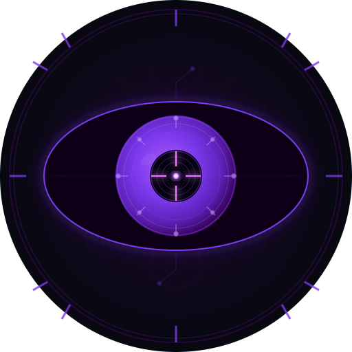

# datawatch

<p align="center"></p>

**Run AI coding and automation work from one place: on your own machines, from your phone, or from chat.**

[](LICENSE)
[](https://go.dev)
[](docs/setup.md)
[](CHANGELOG.md)

datawatch is a program you run on your own computer or server. It starts AI assistants such as Claude Code to do work, watches them, and tells you when they need you, in a web page, on your phone, or in Signal, Telegram, Slack and other chat apps.

It began as a way to answer an AI coding session from Signal or Telegram. It now also plans bigger jobs, remembers what happened, and shares the work across several machines.

<p align="center"></p>

---

## At a glance

- Start and watch AI work from your phone, the web, chat or a terminal
- Give it a goal: it breaks the goal into steps, does them and checks the results
- It remembers past work, so a new session starts with background
- Use one machine or many; the work is shared
- Your data stays on your machines, encrypted and behind a login

---

## Current release

**Current release: v9.129.0 (2026-11-10).** The standard task list now shows each task's real mode (llm, daemon or off) and runner, and the standard task wording is corrected in the MCP descriptions, docs and locale files. Full history: [CHANGELOG.md](CHANGELOG.md). Older highlights: [docs/release-highlights.md](docs/release-highlights.md).

Recent changes, newest first:

- Unreleased: an Automaton keeps a change record and drafts its gate report, changelog entry, parity issue, tracker rows and registry row from it (`datawatch autonomous generated-artefacts`, `change-record`, `generated`; REST `/api/autonomous/generated-artefacts` and `/api/autonomous/prds/{id}/change-record`; MCP `generated_artefacts_get`, `autonomous_prd_change_record`, `autonomous_prd_generated_artefact`, `autonomous_prd_regenerate_artefact`; Settings group "Generated artefacts")
- v9.62: a check keeps machine names and addresses out of the code and docs
- v9.61: a limit keeps weekly Claude usage on budget
- v9.60: the steps of one job can run at the same time
- v9.58: each project sets its own merge steps, plus a setup report
- v9.57: stuck Claude Code prompts are dismissed safely
- v9.50 to v9.55: automatic retries, held work asks you a question, a watch tells slow from hung

---

## Why a control plane and not a bot

A chat bot answers one message at a time. datawatch keeps running: it starts the work, keeps track of it, and reports back.

The same setup works whether the work runs on your laptop, in a container, on another machine, or on a schedule, and you control it the same way from everywhere. One way to set it up, one place to look.

---

## What it does

A map of every part is in [docs/architecture-overview.md](docs/architecture-overview.md).

### Plan and run work

Give it a goal. It splits the goal into steps, runs them, checks each result, and asks you when a decision is yours.

- Breaks a goal into steps and checks each result against the code changes
- Runs steps at the same time when it is safe
- Stops to ask you instead of guessing
- Warns you about failed work and about finished work that has not been merged
- Lines queued work up by kind (bug, maintenance, feature, other) with a visible priority source, and offers new defect filings to the Automation you name
- Points the planner and workers at your project's rules and context files; set the file names under Settings, *Rules and context*, with `datawatch autonomous rules-context`, or with `GET`/`PUT /api/autonomous/rules-context` ([how-to](docs/howto/automata-rules-and-context.md))
- Sets how small each worker, verifier and judge session starts with worker session profiles: which MCP servers, tools, skills, starting context, model and effort a session gets, set per role, task kind, task, Automaton, project or globally; the start-up size and profile name are recorded per attempt and shown in the cost report, stats and usage advice ([how-to](docs/howto/worker-session-profiles.md))

More: [automation API](docs/api/autonomous.md) · [planning routing](docs/howto/automata-planning-routing.md) · [parallel steps](docs/howto/automaton-parallel-tasks.md) · [questions](docs/howto/operator-questions-answering.md) · [priority by kind + defect intake](docs/howto/autonomous-priority-by-kind.md)

### See what agents did

Agent tracing records each tool call, model request, state change and permission decision as a timeline you can read per session or per Automaton.

- Reads one session or a whole Automaton in order, with filters for tool, backend and errors
- Rolls up time, errors and tokens by session, task, story, agent or backend
- Shows how much of each backend's activity the trace captures
- Off, summary (default) or full mode under `tracing.*` in the config

More: [how-to](docs/howto/agent-tracing.md) · [configuration](docs/operations.md) · [MCP tools](docs/cursor-mcp.md)

### Choose where AI runs

- Add any computer, GPU machine or cluster as a place to run models
- Name a model and list backups for when a machine is busy
- Browse models that fit your hardware
- Drain a machine for maintenance so it takes no new work while running work finishes (`datawatch compute node drain` and `undrain`)

- Can read a judge's answer as option probabilities instead of parsing prose (classify mode), and blocks rather than guesses when the numbers are missing
- `datawatch llm classifier status|publishers|add-publisher|verdicts|review` shows what the judge is allowed to do and why a verdict came out as it did; a model's publisher must be on the allowlist you maintain
- See what the automations need against what is configured — the requirements report (`datawatch automation requirements-report`) says what is missing and which backend minimums each node meets, fails or cannot verify
- Decide which models may be pulled before anything is pulled — the model-pull consent gate is default-deny (`datawatch automation model-consent get|set`), with per-model allow/deny notes and publisher allow-lists

More: [compute nodes](docs/howto/compute-nodes.md) · [model list](docs/howto/llm-registry.md) · [classification verdicts](docs/howto/classification-verdicts.md) · [requirements report](docs/howto/automation-requirements.md) · [model pull consent](docs/howto/model-pull-consent.md)

### Memory

- Remembers past sessions and facts, and you can search them
- Keeps private notes apart from notes shared with other machines
- A new session starts with who you are and the background it needs

More: [memory](docs/memory.md) · [shared notes](docs/howto/discussion-scopes.md)

### Several machines

- Connect machines and share work, sessions, files and chat messages
- Each machine gets only the access you give it

More: [channel routing](docs/howto/channel-routing.md) · [file sharing](docs/howto/file-service.md)

### Security

- Data on disk is encrypted
- Passwords and keys live in a vault
- Logins, encrypted connections, and a log of who did what

More: [encryption](docs/encryption.md) · [security review](docs/security-review.md)

### Tools and add-ons

- Plugins and skills, including a community collection
- Service plugins (e.g. imap-mcp): attach to a service you already run, or let the daemon launch and supervise it, with status tiles, token vaulting and down/backlog alerts
- Works with Claude Desktop, Cursor and VS Code
- Claude Code reports its status automatically

More: [skills](docs/skills.md) · [MCP](docs/mcp.md) · [plugin services](docs/plugins.md) · [imap-mcp how-to](docs/howto/imap-mcp-service.md) · [Claude Code hooks](docs/howto/claude-hooks.md)

### Also included

- Chat apps: Signal, Telegram, Discord, Slack, Matrix, Twilio, webhooks, DNS and voice
- AI tools: claude-code, aider, pi, goose, gemini, opencode, ollama, openwebui and shell
- Docker and Kubernetes workers
- Agent tracing: a timeline of what each agent did (tool calls, model requests, permission decisions, loop warnings, errors) for a session or a whole Automaton, with roll-ups and a per-backend coverage badge. On by default at the summary level; settings under `tracing.*` ([how-to](docs/howto/agent-tracing.md))
- Rate-limit recovery, network monitoring, Prometheus metrics and a Tailscale network
- A usage calculator that sizes the parallel lanes to your weekly Claude allowance, with an option for the daemon to apply that advice itself within a cap you set (auto-lanes, off by default)
- A host load watch: one warning when the load average stays high for the minutes you set, naming the busiest processes, and in reap mode also ending the leftover processes of already-ended sessions (`autonomous.host_load_alert`; more: [host load check](docs/howto/host-load-check.md))
- A session-end reap: when a session ends — finished, cancelled or failed — the daemon ends the processes that session left behind, attributing each only by evidence read from `/proc`, never by name (more: [orphan reaping](docs/howto/automata-orphan-reaping.md))

Everything else is in the [Documentation index](#documentation-index).

---

## Installation

### Linux (one-liner)

```bash
curl -fsSL https://raw.githubusercontent.com/dmz006/datawatch/main/install/install.sh | bash
```

Installs to `~/.local/bin` for non-root users, `/usr/local/bin` for root. Includes systemd service.

### From source

```bash
git clone https://github.com/dmz006/datawatch
cd datawatch
go build -o bin/datawatch ./cmd/datawatch
sudo mv bin/datawatch /usr/local/bin/
```

### Update an existing install

```bash
datawatch update && datawatch restart
```

Update is version-string aware. Tmux sessions survive daemon restarts.

---

## Quick start

Three stages, each one a complete, working state on its own — stop after
stage 2 if that's all you need today.

### 1. Install

See [Installation](#installation) above, then initialize + start:

```bash
datawatch config init
datawatch start
curl -ks https://localhost:8443/api/health   # {"status":"ok",...}
```

### 2. Minimal setup — one backend, one session

The fastest path from a fresh install to a real AI session: no messaging
backend, no LLM registry, no MCP server required yet. Pick whichever
coding CLI you already have on your machine — [opencode](https://opencode.ai)
or [Claude Code](https://docs.anthropic.com/en/docs/claude-code):

```bash
# opencode
datawatch config set llm.backends.opencode.enabled true
datawatch config set llm.backends.opencode.path "$(which opencode)"

# — or — claude-code
datawatch config set llm.backends.claude_code.enabled true
datawatch config set llm.backends.claude_code.path "$(which claude)"

datawatch reload
datawatch backends list
#  → opencode | claude-code   ENABLED   reachable

datawatch sessions start --llm opencode --task "Hello, what model are you?" --project-dir /tmp
# (swap --llm claude-code if that's the one you configured)
```

Open `https://localhost:8443` in a browser to watch the session stream
live, or `datawatch sessions tail <id>` from the CLI. This is a
complete, working datawatch install — everything past this point is
additive.

### 3. Full datawatch setup — LLM registry + MCP

Layer on the rest once the minimal path works:

```bash
# Configure your operator identity
datawatch identity configure
# or open the PWA and click the 🤖 robot icon in the header

# Register more backends/hardware in the LLM Registry (ordered
# failover list, not just the one backend from stage 2)
datawatch llm list
datawatch compute node list
datawatch compute pull-model datawatch-ollama llama3.1:8b
datawatch sessions start --llm ollama --model llama3.1:8b --task "Hello"

# Point an MCP host (Claude Desktop / Cursor / VS Code — or a
# datawatch-spawned claude-code/opencode session from stage 2, which
# already has this same MCP server wired in) at the daemon:
#   {"datawatch": {"command": "datawatch", "args": ["mcp"], "env": {"DATAWATCH_TOKEN": "<bearer>"}}}

# (Optional) add a messaging backend
datawatch setup telegram    # or discord / slack / signal
```

Once that MCP host is connected, it can configure datawatch through
plain prompts instead of CLI flags or hand-edited YAML — including
finding out what to do first. Example, verbatim:

> **You:** "What's configured and what isn't? Set up something that's
> missing."
>
> **Claude:** calls `alert_rule_list`, `compute_node_list`,
> `federation_peer_list` — sees two compute nodes and a federation peer,
> but zero alert rules. Calls `docs_search("alert rule")` to confirm the
> schema, then `alert_rule_create` to add one (e.g. GPU usage on your
> RTX node above 90%, cooldown 5 minutes). No restart needed.

Same pattern for anything else: ask what's there, let it read the docs
it needs, let it call the tool. See
docs/howto/setup-and-install.md's MCP section for the fuller
prompt → tool-call reference.

Send `help` in a configured messaging channel to see the command
reference, or see
[docs/howto/setup-and-install.md](docs/howto/setup-and-install.md) for
the full walkthrough of all three stages, and
[docs/howto/chat-and-llm-quickstart.md](docs/howto/chat-and-llm-quickstart.md)
for the most-common chat × backend pairings.

---

## Surface quick reference

Every datawatch feature is reachable from all of these surfaces:

| Surface | Example |
|---|---|
| REST | `curl https://localhost:8443/api/llms` |
| MCP | `llm_list` / `compute_node_list` (via Claude Code / Cursor / VS Code) |
| CLI | `datawatch llm list` / `datawatch compute node list` |
| Comm | `llm list` / `compute node list` (sent in Signal / Telegram / Matrix / etc.) |
| PWA | Settings → Compute → LLM Configuration / Compute Nodes |
| Mobile | Mirrored via Compose Multiplatform app (`dmz006/datawatch-app`) |
| YAML | `~/.datawatch/datawatch.yaml` `compute:` + `llm:` blocks |

The mobile parity rule: every operator-visible PWA change files an issue against `dmz006/datawatch-app` so the Compose pipeline mirrors it.

See [docs/commands.md](docs/commands.md) for the full command reference.

---

## Architecture

➡ **[docs/architecture-overview.md](docs/architecture-overview.md)** — one-screen Mermaid diagram of every interface, subsystem, and data path, with planned features called out.

For deeper drill-downs: [docs/architecture.md](docs/architecture.md) (package list, component diagram, session state machine) · [docs/data-flow.md](docs/data-flow.md) (per-feature sequence diagrams) · [docs/plans/README.md](docs/plans/README.md) (open and planned features tracker).

---

## 📱 [Android — phone, auto, and wearables unified](https://github.com/dmz006/datawatch-app)

**datawatch is now on your wrist, dashboard, and pocket.** Compose Multiplatform with full 7-surface parity across Android, Android Auto, and Wear OS — same capabilities, native to each form factor.

- **Android Auto** — hands-free voice commands via "Hey Google, ask DataWatch for status," live session/vitals monitoring on the infotainment display, quick-decision buttons, urgent push notifications. Three distraction-safe screens.
- **Wear OS** — Automata queue dashboard, **private local voice** (audio goes straight to your own server, transcribed by your own Whisper instance — no Google, no cloud STT), tile shortcuts, ambient progress, health-data cross-reference.
- **Android phone** — full session and Automata orchestration parity with desktop (REST/MCP/CLI), discussion scopes, file uploads, offline queue with auto-sync, bidirectional push replies.

> [](https://groups.google.com/g/datawatch-testers)
>
> **Android is in Google Play closed testing, currently pending Google's app review.** Google requires 12 testers opted in for 14 continuous days before production access. **The opt-in/install links below may not load the app yet** if the review hasn't cleared — if a link 404s or shows nothing to install, the app isn't visible to new testers yet; try again later or watch `dmz006/datawatch-app`'s CHANGELOG for the review-cleared announcement.
>
> 1. [Join the tester group](https://groups.google.com/g/datawatch-testers) with the same Google account your phone uses for Play
> 2. [Opt in on Google Play](https://play.google.com/apps/testing/com.dmzs.datawatchclient)
> 3. [Install from Google Play](https://play.google.com/store/apps/details?id=com.dmzs.datawatchclient) (the listing appears after you opt in, once Google's review clears) and stay opted in for 14 days — **we need 12 testers.**
>
> **Wear OS** is in the same closed test. Once you've opted in, open Play Store on the watch and search **datawatch**, or install it from play.google.com in a browser and pick the watch. Android Auto is part of the phone app.
>
> **iOS:** [public TestFlight beta](https://testflight.apple.com/join/qta87V4Q) — install
> TestFlight from the App Store, open the link on your iPhone/iPad, tap
> **Accept**, then **Install**. Feedback: open an issue in
> [`dmz006/datawatch-app`](https://github.com/dmz006/datawatch-app).

---

## 🎉 Community skills + plugins registry

**[`dmz006/datawatch-community`](https://github.com/dmz006/datawatch-community)** is the official hub for sharing datawatch Skills and Plugins — autonomous session patterns, multi-agent topologies, inter-agent proposal pipelines, and more, contributed by operators and installable in one command:

```bash
datawatch skills registry connect https://github.com/dmz006/datawatch-community
datawatch skills sync community
```

Browse the catalog in-app (Settings → Skills → Registry) or on GitHub. To contribute: fork, add your Skill or Plugin directory, open a PR — see [`CONTRIBUTING.md`](https://github.com/dmz006/datawatch-community/blob/main/CONTRIBUTING.md).

---

## Documentation index

Full documentation lives in [docs/](docs/) — see [docs/README.md](docs/README.md) for a complete index with all flow diagrams.

| Area | Start here |
|---|---|
| Getting started | [docs/setup.md](docs/setup.md) · [docs/commands.md](docs/commands.md) · [docs/pwa-setup.md](docs/pwa-setup.md) |
| Compute + LLM | [docs/howto/compute-nodes.md](docs/howto/compute-nodes.md) · [docs/howto/llm-registry.md](docs/howto/llm-registry.md) · [docs/howto/ollama-marketplace.md](docs/howto/ollama-marketplace.md) |
| Sessions + hooks | [docs/howto/sessions-deep-dive.md](docs/howto/sessions-deep-dive.md) · [docs/howto/claude-hooks.md](docs/howto/claude-hooks.md) |
| Backends | [docs/llm-backends.md](docs/llm-backends.md) · [docs/messaging-backends.md](docs/messaging-backends.md) · [docs/backend-state.md](docs/backend-state.md) |
| Interfaces | [docs/mcp.md](docs/mcp.md) · [docs/howto/mcp-tools.md](docs/howto/mcp-tools.md) · [docs/howto/docs-as-mcp.md](docs/howto/docs-as-mcp.md) · [internal/server/web/openapi.yaml](internal/server/web/openapi.yaml) |
| Autonomous + plugins | [docs/api/autonomous.md](docs/api/autonomous.md)<br>[docs/howto/automation-tab.md](docs/howto/automation-tab.md)<br>[docs/howto/automata-events.md](docs/howto/automata-events.md)<br>[docs/howto/automata-progress.md](docs/howto/automata-progress.md)<br>[docs/howto/automation-lane-fill.md](docs/howto/automation-lane-fill.md)<br>[docs/howto/infrastructure-retry.md](docs/howto/infrastructure-retry.md)<br>[docs/howto/merge-pipeline.md](docs/howto/merge-pipeline.md)<br>[docs/howto/merge-shadow.md](docs/howto/merge-shadow.md)<br>[docs/howto/release-size-and-milestones.md](docs/howto/release-size-and-milestones.md)<br>[docs/howto/release-push-and-tag.md](docs/howto/release-push-and-tag.md)<br>[docs/howto/onboarding-report.md](docs/howto/onboarding-report.md)<br>[docs/howto/automation-requirements.md](docs/howto/automation-requirements.md)<br>[docs/howto/model-pull-consent.md](docs/howto/model-pull-consent.md)<br>[docs/howto/model-request-progress.md](docs/howto/model-request-progress.md)<br>[docs/howto/automation-repo-ci-watch.md](docs/howto/automation-repo-ci-watch.md)<br>[docs/howto/automation-security-failure.md](docs/howto/automation-security-failure.md)<br>[docs/howto/supervisor-loop.md](docs/howto/supervisor-loop.md)<br>[docs/howto/automaton-search-before-create.md](docs/howto/automaton-search-before-create.md)<br>[docs/howto/automata-tags.md](docs/howto/automata-tags.md)<br>[docs/howto/automata-tag-registry.md](docs/howto/automata-tag-registry.md)<br>[docs/howto/automata-checks-and-ship.md](docs/howto/automata-checks-and-ship.md)<br>[docs/howto/generated-artefacts.md](docs/howto/generated-artefacts.md)<br>[docs/flow/tag-registry-sync-flow.md](docs/flow/tag-registry-sync-flow.md)<br>[docs/api/orchestrator.md](docs/api/orchestrator.md)<br>[docs/api/plugins.md](docs/api/plugins.md)<br>[docs/plugins.md](docs/plugins.md)<br>[docs/howto/imap-mcp-service.md](docs/howto/imap-mcp-service.md)<br>[docs/skills.md](docs/skills.md)<br>[docs/howto/result-panel.md](docs/howto/result-panel.md) |
| Comms + federation | [docs/howto/channel-routing.md](docs/howto/channel-routing.md) · [docs/howto/file-service.md](docs/howto/file-service.md) · [docs/howto/discussion-scopes.md](docs/howto/discussion-scopes.md) · [docs/howto/comm-channels.md](docs/howto/comm-channels.md) |
| Memory & intelligence | [docs/memory.md](docs/memory.md) · [docs/memory-usage-guide.md](docs/memory-usage-guide.md) |
| Operations & security | [docs/operations.md](docs/operations.md) · [docs/config-reference.yaml](docs/config-reference.yaml) · [docs/encryption.md](docs/encryption.md) · [docs/multi-session.md](docs/multi-session.md) · [docs/uninstall.md](docs/uninstall.md) |
| Community | [`dmz006/datawatch-community`](https://github.com/dmz006/datawatch-community) |
| Source attribution | [docs/plan-attribution.md](docs/plan-attribution.md) |

---

## Prerequisites

| Dependency | Version | Notes |
|---|---|---|
| [signal-cli](https://github.com/AsamK/signal-cli) | ≥ 0.13 | Optional — Signal protocol bridge |
| Java | ≥ 17 | Optional — required by signal-cli |
| [tmux](https://github.com/tmux/tmux) | Any recent | Session management |
| [ollama](https://ollama.com) | Any recent | Optional — local LLM inference |
| [claude CLI](https://docs.anthropic.com/en/docs/claude-code) | Latest | Optional — claude-code backend |
| [Tailscale](https://tailscale.com) | Any | Optional — for PWA + mesh |
| Go | 1.24+ | Only required for building from source |

---

## License

Polyform Noncommercial 1.0.0. See [LICENSE](LICENSE).

Commercial licensing inquiries: open an issue.

---

## Acknowledgements

Special thanks to **[Daniel Keys Moran](https://en.wikipedia.org/wiki/Daniel_Keys_Moran)** and his novel
**[The Long Run](https://www.amazon.com/Long-Run-Daniel-Keys-Moran/dp/1939888336)** — the story of Trent
the Uncatchable, a thief and hacker operating under the eye of an all-seeing AI surveillance network, sparked a
decades-long obsession with the intersection of technology, autonomy, and the systems that watch over us.
That spirit lives somewhere in this project.

> *"The DataWatch sees everything."*

If you haven't read it: [buy it on Amazon](https://www.amazon.com/Long-Run-Daniel-Keys-Moran/dp/1939888336)
(Kindle edition also available), or borrow it from the
[Internet Archive](https://archive.org/details/longruntaleofcon0000mora).
Daniel has also historically offered copies by email request via his
[blog](https://danielkeysmoran.blogspot.com).

### Additional Acknowledgements

Datawatch's design also borrows heavily from three projects, with full attribution in [docs/plan-attribution.md](docs/plan-attribution.md):

- **[HackingDave/nightwire](https://github.com/HackingDave/nightwire)** — Signal-driven AI coding bot. Episodic memory + Signal-as-control-plane shape.
- **[milla-jovovich/mempalace](https://github.com/milla-jovovich/mempalace)** — Memory palace metaphor, 4-layer wake-up stack, full 6-axis spatial schema, conversation mining, repair self-check.
- **[danielmiessler/Personal_AI_Infrastructure (PAI)](https://github.com/danielmiessler/Personal_AI_Infrastructure)** — Identity / Telos, Algorithm Mode 7-phase, Skills, Evals, Council, ISA generalization.

---

## Contributing

Issues + PRs welcome. Read [AGENT.md](AGENT.md) for the operating rules — every commit follows the documented Pre-Execution / Versioning / Documentation / Mobile-Parity / Secrets-Store rules.
