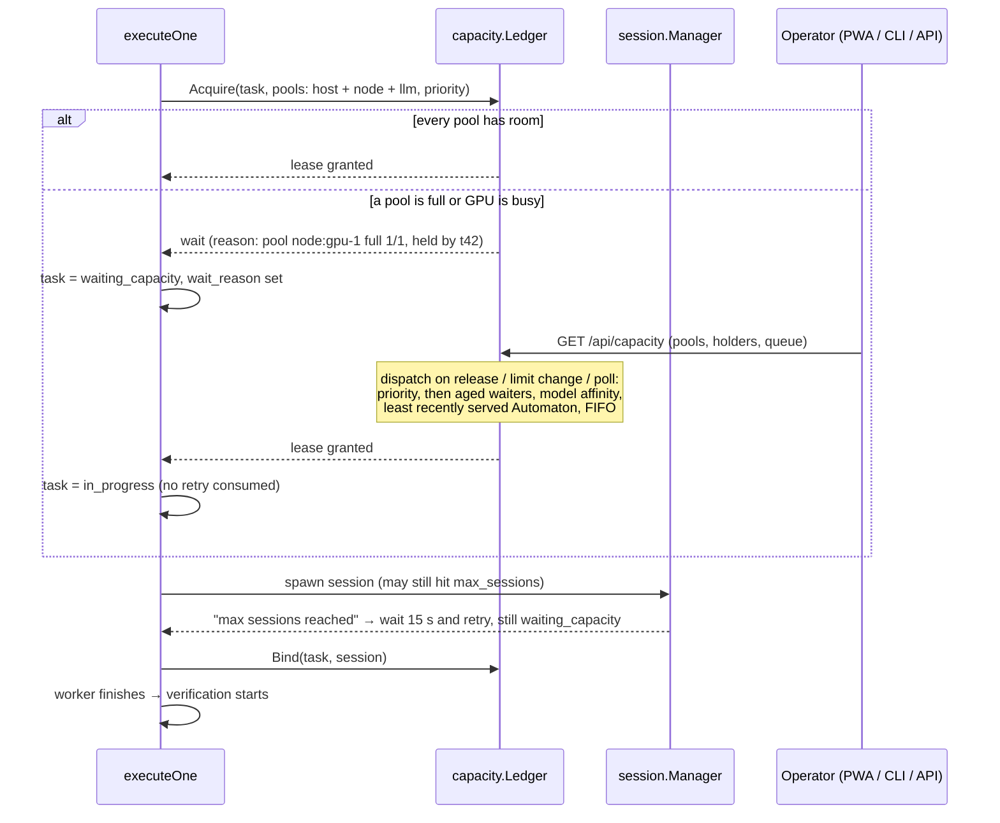

# Automata capacity admission flow

How a task gets a slot before its session starts, what the operator
sees while it waits, and how decompose, verification and external waits
share the same pools.

## Task spawn



## Verify holds the same slot

```mermaid
sequenceDiagram
    participant Ex as executeOne
    participant L as capacity.Ledger
    participant V as verifier

    Ex->>L: Handoff(task → verify:<task>) — the worker lease is re-keyed<br/>to the verifier, not released and re-acquired
    Note over L: no window where a sibling can steal the slot;<br/>the task is never counted twice
    alt verifier's backend/model resolves to the same pool set
        L-->>Ex: same slot now held by the verifier
    else different pool set
        L-->>Ex: hand-off refused → verifier is admitted separately<br/>with its own lease; a second slot is never stacked
    end
    Ex->>V: verify (one slot held throughout)
    Ex->>L: Release(task) on finish
```

## Decompose (planner) is capacity-gated

```mermaid
sequenceDiagram
    participant D as decompose
    participant L as capacity.Ledger
    participant Op as Operator (PWA / CLI / API)

    D->>L: Acquire(plan:<prd>, pools: node + llm, role = planner —<br/>host excluded, ranks AFTER workers and verifiers)
    alt pool saturated
        L-->>D: wait — PRD stays in "planning"<br/>(wait_reason: capacity: planner waiting …)
        Op->>L: GET /api/capacity / PRD status shows the wait
        Note over D: bounded by capacity_wait_timeout_seconds;<br/>cancel/reject drops the planner immediately<br/>(reported as cancelled, retry budget untouched)
        L-->>D: lease granted → decompose proceeds (no re-submit)
    else pool has room
        L-->>D: lease granted
    end
    D->>L: Release(plan:<prd>) on success, error, timeout, cancel
```

## Worker parks on an external condition

```mermaid
sequenceDiagram
    participant S as worker session
    participant Ex as executor / manager
    participant L as capacity.Ledger

    S-->>Ex: DATAWATCH_AWAIT_EXTERNAL: CI run on the branch
    Ex->>Ex: task = waiting_capacity,<br/>reason: await_external: CI run on the branch
    Ex->>L: Release(task) — the slot goes back to the pool immediately
    Note over Ex: project-tree write lock is released too,<br/>UNLESS the tree has uncommitted changes or commits<br/>unreachable from a remote-tracking ref (unpushed work keeps it)
    L-->>Ex: lease granted (normal bounded capacity wait)
    Ex->>S: re-prompt the parked session: re-check the condition,<br/>continue on the same session<br/>(no fresh spawn, no retry or failure counted;<br/>stall/idle detectors suspended while parked)
```

A daemon restart re-adopts a parked task whose session survived (or
re-queues it if the session is dead). Each cycle emits the
`autonomous_idle_wait_release` audit event naming the pools and tree
lock it released.

## Pools

| Pool | Limit from | Counts |
|---|---|---|
| `host` | `session.max_sessions` minus `session.reserved_interactive` | autonomous leases plus operator sessions on this host |
| `node:<name>` | node `max_concurrent_sessions` | autonomous sessions on that node |
| `llm:<name>` | LLM `max_inflight` if > 0; else its `plan_tier` mapped through `autonomous.plan_tier_max_inflight` (default `pro: 1, max_5x: 2, max_20x: 4, api: 0`); else the kind default (1 for subscription kinds, unlimited for local and API kinds) | autonomous sessions on that LLM |

A limit of 0 means unlimited. The planner (decompose) lease covers the
`node:` / `llm:` pools but not `host` — the planning one-shot already
counts against `host` directly. Every lease carries exactly one slot:
the verify hand-off re-keys the worker's lease instead of stacking a
second one, and the await-external cycle returns the slot to the pool
while the task waits.
