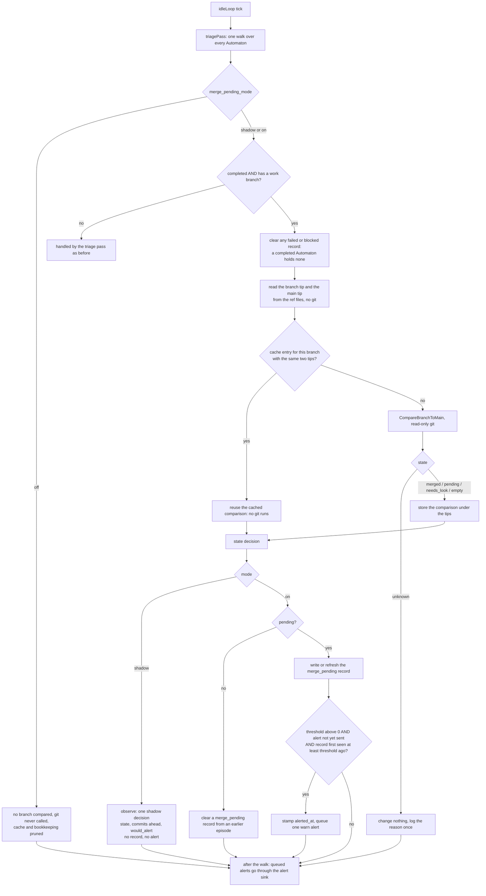
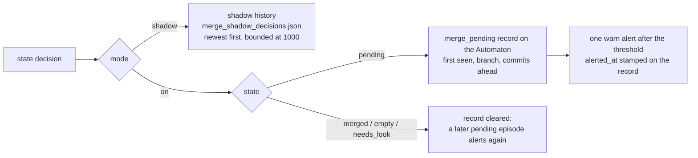

# Automation merge-pending flow

How the coordinator's poll decides whether a finished Automaton's work branch
has reached `main`, how that answer is cached so a quiet poll runs no git, and
how the one decision splits into two different outputs: a recorded shadow
decision, or (in `on` mode) a merge-pending record and a single alert. The
check only reads; nothing in this flow merges, deletes, pushes or checks out a
branch.

## The poll tick

The coordinator's idle loop ticks (1 minute by default). Each tick runs the
triage pass over every Automaton, and that same walk is where the
merge-pending check runs. The check is controlled by
`autonomous.automation.merge_pending_mode`:

- `off` (default): no branch is compared, git is never called, the in-memory
  cache and bookkeeping are pruned empty.
- `shadow`: the check runs and writes a bounded history of what it decided.
  It writes no record and raises no alert.
- `on`: the check runs, a pending Automaton gets a `merge_pending` record, and
  a pending Automaton that has waited long enough raises one alert.

Only an Automaton that is **completed** and has a **work branch** is looked at.
A failed or blocked Automaton still goes through the triage pass as before.

## The cache keyed by tip shas

Comparing a branch takes several git calls, so the answer is cached in memory
per branch together with the two object ids it was made at: the tip of the
Automaton branch and the tip of `main`.

1. Each tick the tips are read straight from the repository's ref files (loose
   refs, then `packed-refs`), which costs no git process.
2. If the layout cannot answer (a symbolic ref, reftable storage, an
   unreadable repository), one `git rev-parse` for both branches is used
   instead, bounded by a 30 second deadline.
3. If the cache holds an entry for the branch whose two tips both match, that
   result is reused and **no git runs**. If either tip moved, because the
   branch got a commit or `main` advanced, the branch is compared again and the
   entry replaced.
4. An `unknown` result is never cached. The reason is logged once per distinct
   failure, so an unchanged failure does not fill the log every poll, and the
   branch is left exactly as it was.
5. After each walk, cached entries for branches that are no longer finished
   Automata with a branch are dropped, so the cache stays bounded by the number
   of finished Automata.

The cache lives in memory only. A daemon restart starts it empty and the first
tick fills it. The merge reads (REST, MCP, CLI, chat, PWA) are served from this
cache and never run git themselves, which is why an Automaton not yet compared
reads as unknown.

## The git cherry and subject check

`CompareBranchToMain` asks git three read-only questions about the range
`main..branch`:

| Question | Command | Result kept |
|---|---|---|
| How many commits does the branch have that `main` does not? | `git rev-list --count main..branch` | commits ahead |
| Is each commit's patch already on `main`? | `git cherry main branch` | count of `+` lines (patch not on `main`) and `-` lines (patch on `main`) |
| Is each commit's subject line on `main`? | `git log main..branch --format=%s` against `git log main --format=%s` | true when every branch subject is an exact line of the `main` log |

Any git error makes the whole result `unknown`, with the error text kept.

## The state decision

The three answers are turned into one state, with the rules applied in order:

| Order | Condition | State |
|---|---|---|
| 1 | no commits ahead | `empty` |
| 2 | every patch is on `main` and every subject is on `main` | `merged` |
| 3 | every patch is on `main` but a subject is not | `needs_look` |
| 4 | some patch is not on `main` and some subject is not on `main` either | `pending` |
| 5 | some patch is not on `main` but every subject is | `needs_look` |

Rows 3 and 5 are the two cases where the patch test and the subject test
disagree. The check does not guess in those cases: a commit that was merged and
then changed on the way in (a conflict fixed by hand, for example) lands in
row 5, so it is shown as needs a look rather than called merge pending.

## Shadow recording and the on-mode alert

The state is the same in both modes. What differs is what is done with it.

**Shadow mode records, and nothing else.** For each finished Automaton with a
branch, the tick writes a decision holding the Automaton id and name, the
branch, the state, the commits ahead and `would_alert`, which says whether an
alert would have fired by now given `merge_pending_alert_minutes` (always false
when that is `0`). To work that out shadow mode tracks, in memory, when each
Automaton was first seen pending. A decision identical to the newest one for
the same Automaton is not written again: it only raises that entry's repeat
count and moves its last-seen time, and the file is flushed once per walk, so
a quiet poll adds no new rows. No merge-pending record is written and no alert
is raised, and a leftover record from an earlier `on` period is cleared.

**On mode records and alerts.** A pending Automaton gets a `merge_pending`
record stamped with the time it was first seen; the record is refreshed only
when it changed. Once it has stood for `merge_pending_alert_minutes` (default
30) and no alert has been sent for it, the tick stamps the alert time on the
record and queues exactly one `warn` alert, which goes out through the same
alert sink as the triage alert once the walk finishes. Stamping the time before
saving is what stops a reload from alerting again, so the alert fires once per
episode. `0` turns the alert off while the record is still written and shown.
When the branch stops being pending (merged, empty or needs a look) the record
is cleared, so a later pending episode starts again and alerts again. An
`unknown` branch changes nothing: it neither starts nor ends an episode.

## Reading the result

| Surface | Merge state (served from the cache) | Safe-to-delete report (runs git when read) |
|---|---|---|
| REST | `GET /api/autonomous/merge` | `GET /api/autonomous/safe-to-delete` |
| MCP | `autonomous_merge` | `autonomous_safe_to_delete` |
| CLI | `datawatch autonomous merge` | `datawatch autonomous safe-to-delete` |
| Comm channel | `autonomous merge` | `autonomous safe-to-delete` |
| PWA | merge badge on a finished Automaton and its Automation card | card on the Automation Overview sub-tab |

The safe-to-delete report reuses the same comparison for each local
`automaton/*` branch but is not part of the poll tick: it is computed when it
is read, works in every mode including `off`, and only lists; it never deletes.

For the operator reference see the *Merge-pending check* section of
[operations.md](../operations.md); for the neighbouring poll-time pass see
[automation-triage-flow.md](automation-triage-flow.md).
