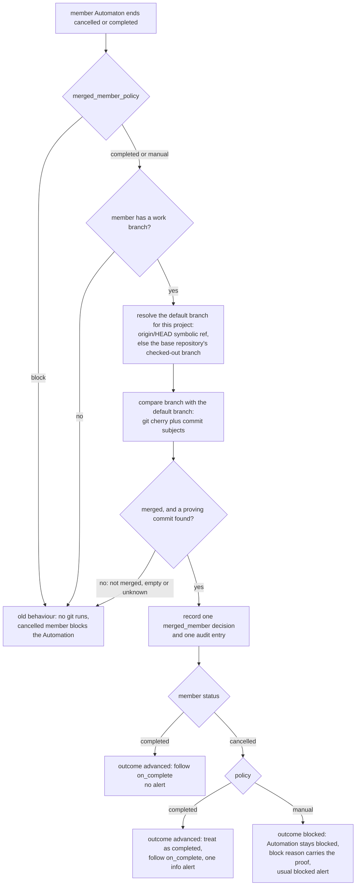
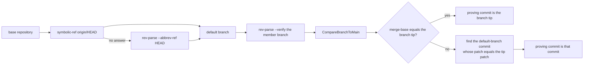
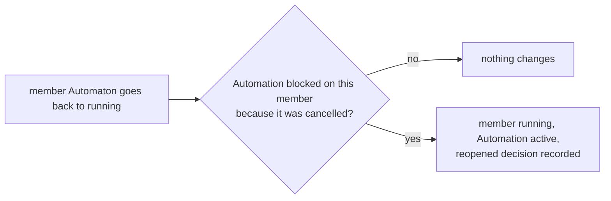

# Automation merged-member flow

How the coordinator decides what to do when a member Automaton of an
Automation ends cancelled or completed: it asks read-only git whether the
member's branch is already merged on the project's own default branch, and the
`autonomous.automation.merged_member_policy` key then decides whether the
Automation moves on or stays blocked. Nothing in this flow merges, deletes,
pushes or checks out a branch.

## The member-end decision

The check runs when a member ends. A member that ends any other way (failed,
for example) is not looked at, and a fork branch carries no outcome edge, so
only a non-branch member can be blocked by this path.

## What the proof is

Every git command in the proof is a read (`symbolic-ref`, `rev-parse`,
`rev-list`, `cherry`, `log`, `diff-tree`, `merge-base`). Any git error, a
missing repository or branch, or a default branch git cannot name gives "not
merged" with the reason kept, so the Automation keeps its blocked outcome.

## The policy at a glance

| Policy | Branch not merged or unknown | Branch proved merged, member cancelled | Branch proved merged, member completed |
|---|---|---|---|
| `completed` (default) | Blocked | Advanced, one info alert | Advanced, no alert |
| `manual` | Blocked | Blocked, block reason carries the proof | Advanced, no alert |
| `block` | Blocked, no git run | Blocked, no git run | Follows the member's normal outcome, no git run |

## Reopening a member

A reopened member never revives an Automation that is cancelled, completed,
paused or blocked for another reason, and a repeated running event does
nothing a second time.

## Reading the result

| Surface | How |
|---|---|
| REST | `GET /api/automations/merged-members`, `GET /api/automations/{id}/merged-members` |
| MCP | `automation_merged_members` |
| CLI | `datawatch autonomous merged-members [automation-id]` |
| Comm channel | `autonomous merged-members [automation-id]` |
| PWA | **Automaton merged-member decisions** block on the Automation detail view, and the decision log line |

For the operator guide see
[howto/automation-merged-member.md](../howto/automation-merged-member.md); for
the comparison this flow reuses see
[automation-merge-pending-flow.md](automation-merge-pending-flow.md).
