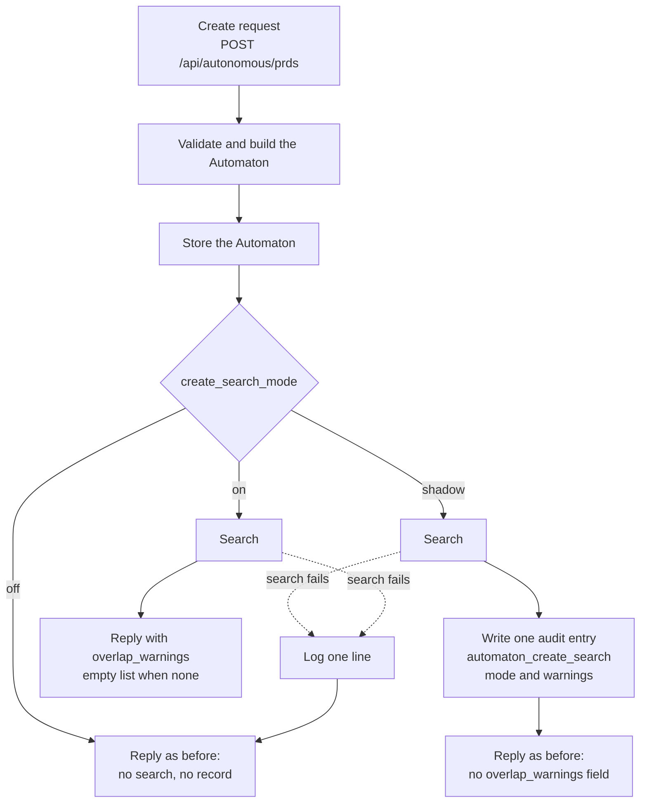
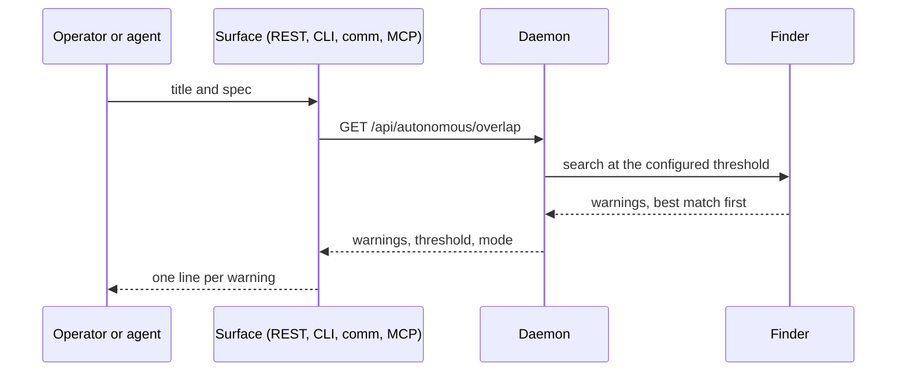

# Automaton create overlap flow

How the create-time check runs when an Automaton is created: create, store,
search, then either the reply or the audit record. For how to read the
warnings, see [the how-to](../howto/automaton-search-before-create.md).

## The path of one create

## Step by step

1. **Create.** The request reaches the create route. The title and spec are
   checked and the Automaton is built exactly as it was before this check
   existed.
2. **Store.** The Automaton is saved. This happens before the search, so the
   search can never stop a create, and the stored record is never changed by it.
3. **Search.** If the mode is `shadow` or `on`, the finder compares the new
   title and spec with three sources, each in its own protected call:
   - every Automaton in the store, except the one just created;
   - the registry rows in `docs/plans/README.md`;
   - the unmerged `automaton/` branches (name plus commit subjects).

   A match needs at least three shared words and a score at or above the
   threshold. A source that fails or crashes becomes one `unavailable` warning
   and the other sources still run. If there is no project directory to read,
   the registry and branch sources are skipped.
4. **Either the response or the audit record.**
   - In `on` mode the warnings, best match first, go into the create reply as
     `overlap_warnings`. The list is empty when nothing matched.
   - In `shadow` mode the warnings go to the audit log as one
     `automaton_create_search` entry whose subject is the new Automaton. The
     reply is not changed.
   - In `off` mode nothing is searched and nothing is recorded.
   - If the search as a whole fails, the daemon logs one line and the reply is
     the `off` reply.

## The read-only search

The same finder serves `GET /api/autonomous/overlap`, the CLI
`datawatch autonomous overlap`, the comm verb `autonomous overlap` and the MCP
tool `autonomous_overlap_search`. These reads exclude no Automaton, write no
audit entry, and run in every mode.

## What is stored, and where

| Data | Where | Written by |
|---|---|---|
| The new Automaton | the Automaton store | the create route, before the search |
| The shadow record | the operator audit log, action `automaton_create_search` | the create route, in `shadow` mode only |
| The warnings in a reply | nowhere; they travel in the reply | the create route, in `on` mode only |
| The mode and the threshold | the config file | the operator |

Nothing else is written. The registry file and the branches are only read.
