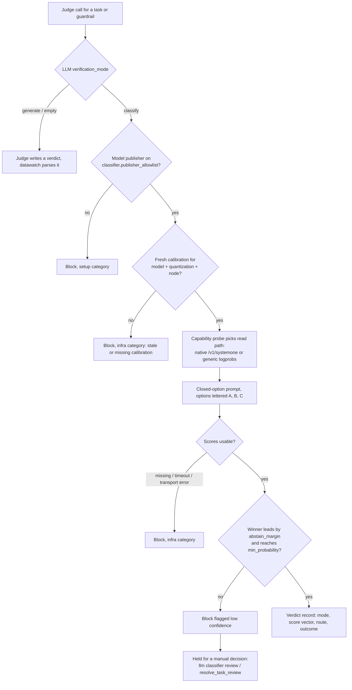

# Classification verdict flow

How a verification or guardrail judge reaches a verdict in **classify** mode, how the
publisher allowlist gates which models may judge, and where a low-confidence block
goes. Operator walkthrough: [howto/classification-verdicts.md](../howto/classification-verdicts.md).
Definitions: [datawatch-definitions.md](../datawatch-definitions.md#classification-verdicts-and-the-publisher-allowlist).

## Rules the flow enforces

- **Fail closed.** Every infra-category block is retried as infrastructure and is not
  counted against the task. A block is never turned into a pass later, and there is
  no silent fall-back to generate mode.
- **The allowlist is operator-only.** It starts empty. A publisher is added only with
  an explicit confirmation (REST, MCP, CLI or chat), the addition is audited, and
  `PUT /api/config` refuses `classifier.publisher_allowlist`.
- **Tunables** (`classifier.timeout_seconds`, `abstain_margin`, `min_probability`,
  `min_option_mass`, `rotate_options`, the probe and calibration keys) are read on
  every call; see [config-reference.yaml](../config-reference.yaml).
- **The explanation is separate.** The prose shown next to a verdict never changes it.
