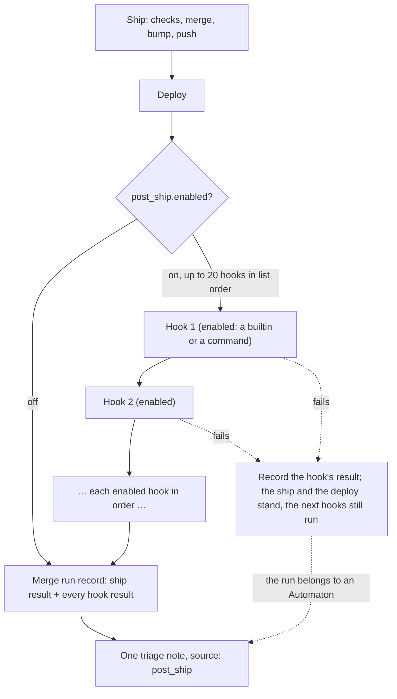

# The post-ship hook flow — the ship, the deploy, the hooks in order, the record

The post-ship hooks are the steps a project runs after the ship. The merge pipeline ships first (the push and then the deploy) and only after that does the daemon run the enabled hooks, in the order the project lists them. Every result lands in the merge run record; a failed hook is recorded and noted, but it never changes the ship.

## The flow

## Step by step

1. The merge pipeline runs its steps in order: checks, merge, version bump, changelog, the optional tag, and the push. The push is the release.
2. The deploy step runs.
3. Only then, with `enabled: true`, the daemon runs the enabled hooks, in list order (disabled hooks are skipped over): each builtin does its step — `registry_row` updates the registry row, `parity_issue` files the issue through the ship runner, `tag` adds the tag if it is not there yet, `notify` sends the rendered template — or runs the hook's command in the project, with the hook name and index exported.
4. The merge run record gets one entry per hook: the state (`ok`, `failed`, `skipped`, `ignored` on the whole block) and the result text (redacted). The record shows exactly which hook did what and what failed. Only for a run that belongs to an Automaton does each failed hook leave one triage note with source `post_ship`.
5. The run ended where the ship ended. The hooks are steps after the ship, and what they show is recorded and, through the `notify` builtin, sent out.

## What a failed hook does — and does not do

For one failed hook:

| It does | It does not do |
|---|---|
| Records the hook's state and result in the merge run record | Change the ship or the push |
| Leaves one triage note with source `post_ship`, when the run belongs to an Automaton | Undo the deploy |
| | Skip the hooks after it — the list keeps its order |
| | Raise an alert by itself — delivery is the `notify` step's job |
