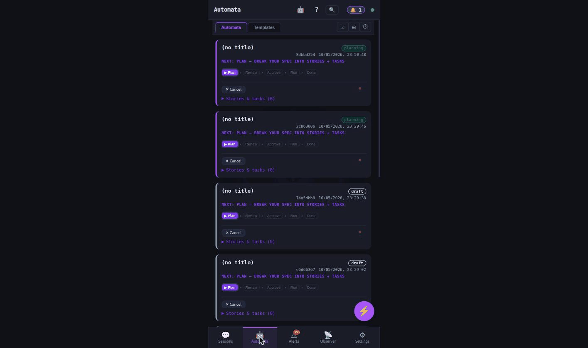
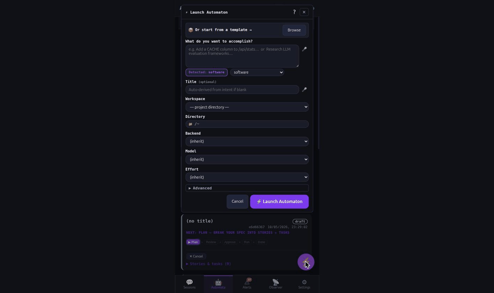

---
docs:
  index: true
  topics: [autonomous, automata, decompose, planning, standard tasks]
exec_params:
  - {name: spec, required: true, description: "Free-form goal specification"}
  - {name: project_dir, required: false, default: "", description: "Project directory (empty = use default)"}
  - {name: type, required: false, default: "software", description: "Automaton type: software | research | operational | personal"}
exec_steps:
  - tool: autonomous_prd_create
    description: Create the Automaton record
    args:
      spec: "{{params.spec}}"
      project_dir: "{{params.project_dir}}"
      type: "{{params.type}}"
    read_only: false
  - tool: autonomous_prd_list
    description: Confirm the new Automaton shows in the list
    args: {}
    read_only: true
---
# How-to: Autonomous planning

Describe a feature in plain English; datawatch **plans** it into a
structured hierarchy of stories + tasks, queues it for review, then
runs the approved tasks under verification.
This howto walks the spawn → plan → review → run loop.

> Planning failed, or a spec check warning on create? See [automata-planning-failures.md](automata-planning-failures.md).

## What it is

An Automaton is a structured spec that the daemon's autonomous
executor walks through: each story has tasks; each task spawns a
session against a configured backend; per-story Evals + scan
guardrails verify output before advancing. Operator-gated approval
(per-story or whole-automaton) keeps the human in the loop.

States: `draft` → `planning` → `needs_review` → `approved` → `running`
→ `blocked` / `completed` / `failed` / `rejected` / `cancelled` /
`archived`.

## Base requirements

- `datawatch start` — daemon up.
- A configured LLM backend (claude-code, opencode-acp, ollama, etc.).
  See [`llm-registry.md`](llm-registry.md) for registering and managing
  LLM backends.
- For containerised execution: a Cluster Profile. For local execution
  the daemon's host runs each task directly. See
  [`profiles.md`](profiles.md) for Cluster Profile setup.
- (Optional) An Evals suite per story for graded verification. See
  [`evals.md`](evals.md).
- (Optional) A Project Profile pre-baked with workspace + skills. See
  [`profiles.md`](profiles.md) and [`skills-sync.md`](skills-sync.md)
  for Skills setup.

## Setup

No setup beyond a backend + (optional) profile.

```sh
# Confirm autonomous subsystem is on (default: yes).
datawatch config get autonomous.enabled
#  → true
```

Optional YAML to pin a planning backend (v7 config key):

```yaml
# ~/.datawatch/datawatch.yaml
autonomous:
  enabled: true
  planning_backend: claude-code   # was "decomposition_backend" before v7.0
  planning_effort: high           # was "decomposition_effort"
  planning_model: ""              # was "decomposition_model" — empty = LLM default
  max_concurrent_tasks: 1         # tasks of one Automaton run at once; 1 = sequential
```

`max_concurrent_tasks` is the daemon-wide default for how many independent
tasks of one Automaton run at the same time. An Automaton's own
`max_concurrent_tasks` overrides it, and tasks of different Automata are not
limited by it. The old `max_parallel_tasks` key is deprecated: it never had
any effect, is accepted and ignored with a startup warning for one release,
and will then be removed.

The old keys (`decomposition_backend` / `decomposition_effort` /
`decomposition_model`) are still accepted on read for backward
compatibility.

## Two happy paths

### 4a. Happy path — CLI

```sh
# 1. Submit a free-form spec.
PRD_ID=$(datawatch autonomous create \
  --name "auth-refactor" \
  --title "Refactor auth to use JWT-only sessions" \
  --goal "Replace cookie+CSRF with JWT-only; deprecate the cookie middleware" \
  --backend claude-code \
  --profile prod-audit 2>&1 | grep -oP 'id=\K[0-9a-f]+')

# 2. Trigger planning (LLM-driven; async).
#    "prd-plan" is the canonical command; "prd-decompose" is a back-compat alias.
datawatch autonomous prd-plan $PRD_ID
sleep 60
datawatch autonomous get $PRD_ID
#  → status: needs_review
#    stories:
#      - "Audit current auth flow" (3 tasks)
#      - "Implement JWT issuance" (4 tasks)
#      - "Migrate session middleware" (5 tasks)
#      - "Update tests + docs" (3 tasks)

# 3. Review (see autonomous-review-approve.md for the full review flow).
#    Quick approve all if it looks good:
datawatch autonomous approve $PRD_ID

# 4. Run.
datawatch autonomous run $PRD_ID

# 5. Watch progress.
watch -n 5 "datawatch autonomous get $PRD_ID | jq '{status, stories: .stories|map({title, status, completed_tasks})}'"

# 6. Inspect a specific story / task on completion.
datawatch autonomous get $PRD_ID --story 1 --task 2

# 7. Cancel mid-run if needed.
datawatch autonomous cancel $PRD_ID

# 8. Clean up after archival.
datawatch autonomous delete $PRD_ID
```

### 4b. Happy path — PWA

1. Bottom nav → **Automata** tab.
   The list is **active-first sorted**: waiting-input / needs-review →
   blocked → running → planning → completed/archived. Each card shows
   the automaton name, status badge, and last-activity timestamp.
   - **Pin** (📌) any card to lock it at the top regardless of state.
     Pin state persists across reloads.
   - **Inline actions** on each card: Open / Pause / Resume / Cancel /
     Approve (Approve is highlighted yellow when the automaton needs
     your attention).
2. Click the **⚡** FAB → wizard:
   - Top strip: **Start from template** (if you have any saved).
   - Intent: free-text spec.
   - Inferred: type / workspace (auto-derived from intent).
   - Execution: backend / effort.
   - Advanced (collapsed): guided mode, scan, rules, story-approval.
   - **Start**.
3. The automaton appears in the list with status `planning`. Click it to
   open the detail view.
4. Detail view 4-tab layout:
   - **Overview** — spec + status + persistent toolbar.
   - **Stories** — per-story state + Edit / Profile / Files /
     Approve / Reject. Click the ▶ triangle to expand a story's
     tasks inline; click again to collapse. First click works
     immediately — no navigation required.
   - **Decisions** — every state-changing event with expandable
     `details` payload.
   - **Scan** — Run Scan + history.
   The detail header also shows the **initial spec** (expandable —
   click "show full" if the spec exceeds 280 characters).
5. When `status: needs_review`, click **Approve** in the toolbar (or
   per-story approve in the Stories tab — see
   [`autonomous-review-approve.md`](autonomous-review-approve.md)).
6. Click **Run** in the toolbar. The status transitions to `running`.
   While running or decomposing the header shows **status graphs**:
   a ✓/✗ decompose indicator, total story + task counts, and a
   per-story progress bar (X/Y tasks, %) with async CPU%/RSS data
   from active compute envelopes.
7. To cancel mid-run: **Cancel** is always visible in the toolbar for
   non-cancelled automata (including while running). To archive when
   complete: **Archive**.

## Other channels

### 5a. Mobile (Compose Multiplatform)

Same Automata tab + ⚡ FAB + 4-tab detail view. Multi-select bar with
state-aware actions matches the PWA.

### 5b. REST

```sh
# Create.
curl -sk -X POST -H "Authorization: Bearer $TOKEN" \
  -H "Content-Type: application/json" \
  -d '{"name":"auth-refactor","title":"...","goal":"...","backend":"claude-code"}' \
  $BASE/api/autonomous/prds

# Plan (canonical endpoint; /decompose is a back-compat alias).
curl -sk -X POST -H "Authorization: Bearer $TOKEN" \
  $BASE/api/autonomous/prds/$PRD_ID/plan

# Get.
curl -sk -H "Authorization: Bearer $TOKEN" $BASE/api/autonomous/prds/$PRD_ID

# Approve / Run / Cancel / Archive.
curl -sk -X POST -H "Authorization: Bearer $TOKEN" $BASE/api/autonomous/prds/$PRD_ID/approve
curl -sk -X POST -H "Authorization: Bearer $TOKEN" $BASE/api/autonomous/prds/$PRD_ID/run
curl -sk -X POST -H "Authorization: Bearer $TOKEN" $BASE/api/autonomous/prds/$PRD_ID/cancel
curl -sk -X POST -H "Authorization: Bearer $TOKEN" $BASE/api/autonomous/prds/$PRD_ID/archive

# Hard delete.
curl -sk -X DELETE -H "Authorization: Bearer $TOKEN" \
  "$BASE/api/autonomous/prds/$PRD_ID?hard=true"
```

### 5c. MCP

Tools: `autonomous_prd_create`, `autonomous_prd_get`,
`autonomous_prd_list`, `autonomous_prd_decompose` (also accepts
`planning_backend` / `planning_effort` / `planning_model` params),
`autonomous_prd_approve`, `autonomous_prd_run`, `autonomous_prd_cancel`,
`autonomous_prd_children`.

Useful when an autonomous LLM coordinator spawns work for itself —
calls `autonomous_prd_create` + `autonomous_prd_decompose` to plan,
then iterates the result.

### 5d. Comm channel

```
You: automaton: Refactor auth to use JWT-only sessions
Bot: started automaton abc123; planning...
Bot (~60s later): automaton abc123 needs_review
       4 stories / 15 tasks
       Reply "approve abc123" to run as-is
       Reply "review abc123" for the per-story review
You: approve abc123
Bot: automaton abc123 running; tasks 0/15
Bot (per-task completion): task 1/15 done — "Audit current auth flow"
...
```

### 5e. YAML

Automaton spec lives at `~/.datawatch/autonomous/prds/<id>.yaml`:

```yaml
id: abc123
name: auth-refactor
title: Refactor auth to use JWT-only sessions
goal: Replace cookie+CSRF with JWT-only; deprecate the cookie middleware
backend: claude-code
profile: prod-audit
status: needs_review
stories:
  - title: Audit current auth flow
    status: needs_review
    evals_suite: ""
    tasks:
      - title: Map all uses of CookieAuthMiddleware
      - title: Document the existing CSRF token flow
      - title: List endpoints currently relying on Set-Cookie
  - title: Implement JWT issuance
    ...
guardrails:
  - rules
  - security
  - release-readiness
```

Edit the YAML directly between `plan` and `approve` to refine the
spec without re-planning. (Use `decompose` alias if scripts require it.)

## Declaring files for write tasks

The plan-coverage check expects a task that writes to say which files it
changes. A task whose title starts with a write verb (`Write`, `Add`, `Update`,
`Create`, `Fix`, `Bump`, `Implement`, `Document`, `Register`, `Wire`, `Make`,
`Move`, `Replace`, `Rename`, `Extend`, `Remove`) must list those files in its
`files` list. A task with no files gets the `write_task_without_files` finding,
which blocks approval in the default `block` mode. See the
[coverage gate](../operations.md#plan-requirement-coverage-gate-autonomousplan_coverage_check)
for the modes and the acknowledge path. Most common noise on a failing
report is the two kinds the findings filters remove by default: files the
plan itself creates, and single words counted as requirements — how to read
and tune each is in [the plan-coverage findings filters guide](plan-coverage-filters.md).

When a task changes nothing, make the **first line of its spec** `READ-ONLY:`
followed by a reason. Only the first non-empty line counts, and the case does
not matter. The check looks only at the marker, so the reason is for the people
reading the plan and is not enforced:

```text
READ-ONLY: audits the retry paths and reports what it finds; no file is edited.
List every call site of the retry helper and note which ones skip the backoff.
```

A read-only task must also be verifiable: give it a `verification_script`
(one repo-relative script file that already exists in the project — a
command like `go build ./... && go test ./...` is not a script), or a
`report_path` under `.datawatch/reports/` where it writes its verdict. The
plan-coverage gate and the decompose lint both refuse a read-only task with
neither, whether it is read-only by the marker or by the `read_only` flag,
because a failure of it would otherwise leave nothing to inspect.

A task that does change files needs no marker; it lists them instead, for
example `internal/config/config.go` and `internal/config/config_test.go` for a
task titled "Add the retry setting to the config loader".

These are exempt without a marker:

- a task of kind `smoke` or `final_gate`;
- a task whose title contains one of the phrases `final gate`, `stability gate`,
  `suite run`, `eval`, `install` or `investigation` as whole words. Only the
  title is matched, never the spec, so a doc task that mentions a test suite in
  its body is still checked.

## Closing tasks from the task-template pack

The task-template pack appends closing tasks to every story that the
planner left out ([the decompose-lint and task-templates
how-to](automaton-decompose-lint.md) covers the pack itself; this
section covers how those closing tasks verify).

Some built-in templates are **daemon-run** — the mode is
`daemon` for `changelog_entry`, `parity_issue_draft`, `bounded_load_step`
and `version_bump_left_to_merge`, and `llm` for `docs_set` and `final_gate`
(see the [template mode
section](automaton-decompose-lint.md#template-mode-who-runs-the-task)) —
except that the final gate no longer spends a session at all: the
[script gate](automaton-decompose-lint.md#the-script-gate-the-final-gate-no-longer-spends-a-session)
performs it with the daemon doing it, and `daemon` is refused on write
for that id. A
daemon-run task never spawns a worker session or a verifier: the daemon
performs it — writing the generated artefact for the changelog and
parity-issue drafts, or recording the spec as the decision note for the
note templates — and completes it through the normal completion path, and
the structural checks skip it. The verification rules that follow still
apply to `docs_set` (which is `llm` mode) — that is where a closing task
that runs as a session gets judged. For `final_gate` the judgment is the
gate itself: a clean pass completes the task, and a failed check — or a
gate with nothing runnable — fails it.

- **The final gate verifies through its report file, never a command string.** The built-in final gate is read-only and carries **no** verification script of its own: what it runs is what the [script gate](automaton-decompose-lint.md#the-script-gate-the-final-gate-no-longer-spends-a-session) resolves — the task's own script when it names one under `.datawatch/verify/` (it runs alone), else the project gate command (it runs alone), else every script the story's other tasks declare, in order until the first failure — all under `autonomous.script_gate_timeout_seconds` and it writes its verdict and evidence to the one report its `report_path` names under `.datawatch/reports/`. That report file — not a command — is what the gate verifies through, and a command string given where a script is expected is refused, whether by the template's config gate or the gate's own, because a script must be a file.
- **A verification script must be a script file that lives in the project.** A template's `verification_script` names one repo-relative script that already exists as an executable (for example `scripts/verify.sh`), and the verifier's pre-start check runs *that file*. A command string such as `go build ./... && go test ./...` is not a script: a value that looks like a command — whitespace, shell operators, an absolute path, a parent reference or the project root itself — is refused at config write with an error naming the template id, nothing is stored, and a template that still carries one is skipped when the templates are applied, so it never becomes a task the verifier cannot start. The same bar is enforced on the plan side: plan coverage and the decompose lint flag a task whose verification script is not a script file, because a failure of it would otherwise leave nothing to inspect.
- **The note tasks are records, not checks — and in their default daemon mode no verifier ever sees them.** The built-in note tasks — the release version note and the bounded load-step rule — write no files and carry no verification script. In their default `daemon` mode the daemon records the note as the story's decision and completes the task; the decompose lint and the plan-structure checks skip daemon-mode tasks, so they never kick a decompose back and nothing is held against them. If an operator switches either template to `llm` mode, the session path applies instead, and the explicit escape hatch for scriptless work is what carries it: a task may carry a stated **verification-exemption reason** (`verification_script_reason`) explaining why it needs no script, and a task with that exemption passes the plan-structure check with no changes — both built-in note tasks carry one, saying a note task changes no files by design. Where a plan-coverage record does call out a scriptless task (a `missing_verification` finding), you acknowledge it like any other failing surface when the gate is in its default `block` mode (or leave it to the `warn`/`off` modes, which report but do not gate).
- **A read-only task may write exactly one file: its report, and any other change still fails.** The only write a read-only task is allowed is to the one `report_path` it carries, and that path has to live under `.datawatch/reports/`. The read-only tree check that runs after the task compares the tree before and after and sets aside only `.datawatch/` (in which the report lives) plus that one report path. If the task leaves an extra report file under the older `docs/plans/reports/` location, that file is moved under `.datawatch/reports/` and the move is recorded as the decision for the write, so the report file itself does not fail the task. Any other change the task left behind still fails it, and the daemon records that read-only violation, naming the file.
- **Automata decomposed with the old template pack keep working.** This change alters what a fresh template application produces, not what already exists: an Automaton whose stories already carry the old pack's closing tasks keeps running, and the two old standard tasks — the final gate and the release version note — can still be cancelled or removed like any other task, without disturbing the rest of the story.

## Choose the verifier per task, story or Automaton

After a task runs, a verifier LLM judges the work. By default every
task uses the global `autonomous.verification_backend` /
`verification_model` / `verification_effort` (or the
`verification_backends` pool). Since v9.0.67 you can override that per
task, per story or per Automaton while the Automaton is in review
(`needs_review` / `revisions_asked`) or cancelled.

When to use it:

- **Routine tasks** (docs, renames, test fixtures): point the story or
  Automaton at a cheaper, faster verifier, such as a local Ollama model.
- **Risky tasks** (auth, migrations, anything touching data): give the
  one task a stronger verifier and higher effort.
- **Independence:** use a different backend for verifying than for
  doing the work.

Most specific wins: task → story → Automaton → Automation → global. Set a
**backend** at the level you want; a model or effort without any
per-unit backend leaves the verifier on the global path. An explicit
backend also skips the `verification_backends` pool. Send `""` (or an
empty field in the PWA) to clear and inherit again.

```bash
# Stronger verifier for one risky task.
datawatch autonomous prd-set-task-verification-llm <id> --task <task-id> \
  --backend claude-code --model opus --effort high

# Cheaper verifier for a routine story.
datawatch autonomous prd-set-story-verification-llm <id> --story <story-id> \
  --backend ollama --model qwen3:8b

# Clear the task override.
datawatch autonomous prd-set-task-verification-llm <id> --task <task-id> \
  --backend "" --model "" --effort ""
```

PWA: task **Edit**, story **LLM** or Automaton **Set LLM** →
*Verification LLM* row. MCP: `autonomous_prd_set_task_verification_llm`
/ `_set_story_verification_llm` / `_set_verification_llm`. Chat:
`autonomous set-task-verification-llm <id> <task-id> backend=claude-code model=opus`.
REST: `POST /api/autonomous/prds/{id}/set_task_verification_llm`
(see [`../api/autonomous.md`](../api/autonomous.md)).

**Read which verifier actually ran.** After verification, the task's
`verification` object in `datawatch autonomous prd-get <id>` (or
`GET /api/autonomous/prds/{id}`) carries `verifier_backend`,
`verifier_model`, `verifier_effort` and `verifier_source`. The source
tells you where the choice came from: `task`, `story`, `prd` (the
Automaton level), `automation` (the default set on the Automation the
Automaton belongs to), `global`, or `pool`. In the PWA the verification
result shows a **Judged by** line. If you set an override and still see
`global` or `pool`, check that a backend (not just a model) was set.

**Read which backend ran the work.** The same way, each task carries an
`executor_source` field: `task`, `story`, `prd` (the Automaton level),
`automation`, or `global` when no level named a backend. It names the level
that supplied the execution backend for the latest attempt. In the PWA it
shows as an **Executor** line on the task and on the session's status card.
To give a whole chain of Automata one set of defaults, see
[Automation queue advance](automation-queue-advance.md).

## Diagram

```
   draft ──► planning ──► needs_review ──► approved ──► running
                                  │              │           │
                                  │ Reject       │ Cancel    │ Block
                                  ▼              ▼           ▼
                                rejected     cancelled    blocked
                                                              │ resolve
                                                              ▼
                                                          running
                                                              │
                                                              ▼
                                                          completed
                                                              │
                                                              ▼ archive
                                                          archived
```

## Common pitfalls

- **Planning hangs.** Backend slow or unreachable. `datawatch
  autonomous get $PRD_ID` shows `status: planning` for >5 min →
  check backend health (`datawatch llm test <name>`).
- **Approve without review.** Easy to fall into; for non-trivial
  Automata always at least read the Stories tab. Per-story approve gives
  finer control.
- **Run without approve.** Returns 400 (`approval required`). Approve
  first.
- **Story blocks on Evals failure.** That's the safety net working —
  inspect the failed grader, fix or accept-with-rationale.
- **Spec changes mid-run.** Edit-Spec + Run-Continue is supported,
  but the LLM only sees the new spec on the next task spawn; in-flight
  tasks finish under the old spec.
- **Duplicate session for the same task after a retry or daemon
  restart.** Fixed — the executor now kills a task's previous session
  before spawning its replacement, on every path (retry, boot-resume).
  See [`task-session-reconcile-flow.md`](../flow/task-session-reconcile-flow.md).
- **Daemon restart while planning (decompose in flight).** The in-flight
  decompose is no longer discarded: the planner session is not ended and
  the PRD is not reset to `draft`. At boot the daemon re-attaches a
  reader to the live planner session and its output file; if the planner
  session ended it ingests the complete plan; if neither yields a usable
  plan it restarts planning once. The plan then proceeds to review
  (approve/revise) as usual. See [`autonomous-recovery.md`](autonomous-recovery.md)
  (what happens to Automata when the daemon restarts) and
  [`restart-matrix-findings.md`](../plans/restart-matrix-findings.md) for the recorded
  operator decision.

- **Tasks fail with `scope: ...`, or the Overview shows Scope warnings.**
  Workers and the planner are confined to the project directory (the
  PRD's *writable* directories) plus any *read-only* directories. A plan
  that names a path outside them (for example "work in another repo")
  is flagged at planning time and its tasks are refused at start rather
  than wandering. Fix the task text, or open Settings and add the
  directory under Read-only or Writable directories (REST:
  `POST /api/autonomous/prds/{id}/set_dirs`). Put a research
  Automaton's output folder in the project directory, not elsewhere.
- **Tasks show "waiting for capacity".** The host, a compute node or an LLM is full; the task starts when a slot frees and is not failed. See [`automata-capacity.md`](automata-capacity.md).
- **A story shows failed although its files exist.** A story is marked
  completed only when none of its tasks failed. Reset the failed task
  after fixing the cause and the story rolls up again.

## Changing the planning backend while planning

If the PRD is sitting in `planning`, waiting for a capacity slot (see
[`automata-capacity.md`](automata-capacity.md) — the planning call is
capacity-gated like a task), you can still change where it will run. Change
its decomposition pair — `decomposition_profile` (the planning backend) and/or
`decomposition_model` — with `set_llm`; the change takes effect immediately,
without waiting for the run to finish or being cancelled:

- **The run is still queued (not started).** Its single queue entry is
  retargeted in place to the pool the new pair resolves to, and the PRD's wait
  reason is re-surfaced naming the pool it now waits on. The outcome is
  `requeued`. Re-targeting an entry that already sits on the target pool is a
  no-op, so changing the profile twice leaves exactly one queued request and
  no leaked capacity.
- **The run already started (holds a live lease).** It is left entirely
  alone; the new pair applies from the next planning run. The outcome is
  `deferred_to_next_run`, with a plain reason that says to wait for it to
  finish or cancel it.
- **Nothing to move** — the resolved pair is unchanged, no live planning run,
  or the queue entry already sits on the target pool. The value is stored and
  the outcome is `unchanged`.

A requeued run starts no new attempt: it neither consumes the decompose retry
budget nor rolls the PRD back to draft, and the wait budget is not reset — the
run keeps the time bound it was admitted with. Cancelling or rejecting the PRD
still drops a queued planner at once ("decompose cancelled").

The outcome is the `planning` object of the reply (present on `set_llm`
whenever a planning field — `decomposition_profile` or `decomposition_model`
— is part of the call, and on the `decompose` reply while a planning run is
already in flight):

```json
{
  "prd": { "…": "…" },
  "planning": {
    "outcome": "requeued",
    "old_backend": "ollama",
    "new_backend": "claude-code",
    "old_pools": ["llm:ollama"],
    "new_pools": ["llm:claude-code"],
    "reason": "queued planning run re-queued on llm:claude-code"
  }
}
```

`outcome` is `requeued`, `deferred_to_next_run` or `unchanged`; the
`old_*` / `new_*` fields and `reason` are present whenever the answer is not
a plain requeue.

**Restart-decompose.** `decompose` (alias `plan`) is also the restart path:
re-calling it while the planning run is still queued re-queues that same
queued run on the pool the current profile resolves to — the reply carries the
`planning` object above — instead of starting a second run. While the run is
already started it answers plainly that the run is in progress and was left
alone.

```bash
# CLI
datawatch autonomous prd-set-llm <id> --decomposition-profile claude-code
datawatch autonomous prd-plan <id>   # while queued: re-queues on the current pool

# MCP
autonomous_prd_set_llm(id="<id>", decomposition_profile="claude-code")
autonomous_prd_decompose(id="<id>")  # while queued: re-queues on the current pool

# REST
curl -sX POST http://localhost:7433/api/autonomous/prds/<id>/set_llm \
  -H "Content-Type: application/json" \
  -d '{"decomposition_profile":"claude-code"}'
curl -sX POST http://localhost:7433/api/autonomous/prds/<id>/decompose

# Comm channel
autonomous set-llm <id> decomposition_profile=claude-code
autonomous decompose <id>
```

## Linked references

- See also: [`autonomous-review-approve.md`](autonomous-review-approve.md) — the review flow.
- See also: [`automata-orchestrator.md`](automata-orchestrator.md) — composing Automata into DAGs.
- See also: [`evals.md`](evals.md) — per-story graded verification.
- See also: [`profiles.md`](profiles.md) — Project + Cluster Profiles.
- See also: [`../flow/task-session-reconcile-flow.md`](../flow/task-session-reconcile-flow.md) — session/task tracking + cleanup on retry and restart.
- Architecture: `../architecture-overview.md` § Autonomous executor.

## Screenshots





<!-- Screenshots still needed: Automaton detail Overview/Stories/Decisions/Scan tabs, multi-select bar -->

---

## Live progress in the Status tab

While an Automaton is running, open any of its worker sessions and switch to
the **Status** tab to see a live task tree updated in real time via WebSocket.
Each story in the Automata detail view also shows a "● Status" quick-link to
jump directly to that worker session's Status tab.

The pi progress snapshot (assistant turns, tool-call counts, last action,
tokens) is task data: it sits on the running task's card in this tab and on
the task object over every surface. The session view itself no longer
carries its own live progress strip (removed in 9.31.3 — it took a lot of
room and once showed another session's stale pi log numbers on a non-pi
session); for pi sessions the data is still available at
`GET /api/sessions/{id}/progress`, which 404s for non-pi sessions rather
than reading any log that is not the session's own.

## See also

- [datawatch-definitions](../datawatch-definitions.md)
- [howto/autonomous-review-approve](autonomous-review-approve.md)
- [howto/automaton-decompose-lint](automaton-decompose-lint.md) — the decompose-lint quality check and the standard tasks the closing tasks come from
- [howto/automata-orchestrator](automata-orchestrator.md)
- [howto/sessions-deep-dive](sessions-deep-dive.md)
- [howto/algorithm-mode](algorithm-mode.md)
- [howto/evals](evals.md)
- [howto/council-mode](council-mode.md)
- [howto/skills-sync](skills-sync.md) — sync PAI and community registries; use skills in sessions
- [Community skills + plugins](https://github.com/dmz006/datawatch-community) — ready-made skills for autonomous session patterns, polity topology, and more
- [api/autonomous](../api/autonomous.md)
