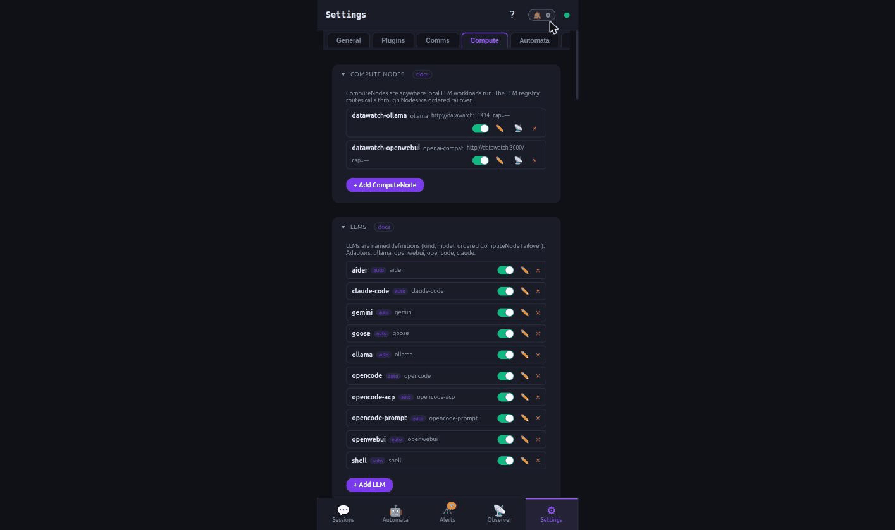
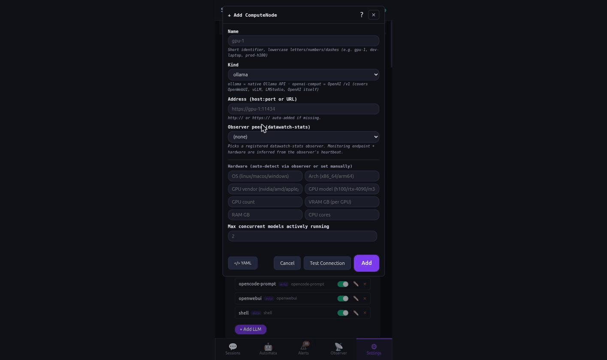
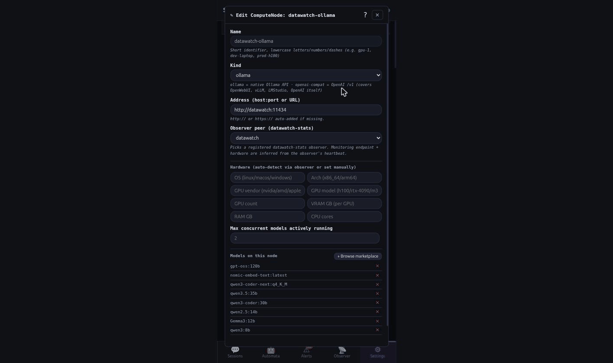
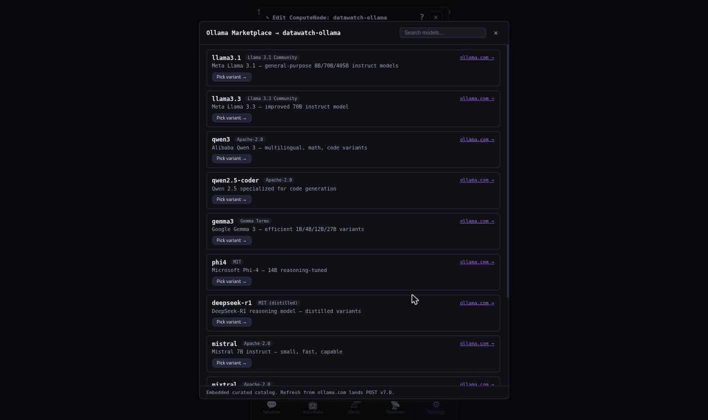

---
docs:
  index: true
  topics: [compute, llm, v7, nodes, ollama, openai-compat, gpu, scheduling]
exec_params:
  - name: name
    description: ComputeNode name (kebab-case, e.g. gpu-box-1)
    required: true
  - name: kind
    description: API protocol the node speaks — ollama or openai-compat
    required: true
  - name: address
    description: URL of the LLM endpoint (e.g. http://gpu-box:11434)
    required: true
exec_steps:
  - tool: compute_node_add
    description: Register the new ComputeNode
    args:
      name: "{{params.name}}"
      kind: "{{params.kind}}"
      address: "{{params.address}}"
    read_only: false
  - tool: compute_node_health
    description: Verify the node is reachable and not in maintenance
    args:
      name: "{{params.name}}"
    read_only: true
---
# How-to: Compute Nodes

A Compute Node is the registry entry that tells datawatch where an LLM endpoint lives — a local machine, a remote GPU box, a cluster, or any host running an Ollama or OpenAI-compatible server. Every LLM in the LLM registry references one or more Compute Nodes for failover. Sessions, Council debates, `/api/ask`, and Automata all route through this layer.

This guide covers the full lifecycle: what a Compute Node is, how to add one through every available channel, how to monitor it, and how to troubleshoot problems.

## What it is

A Compute Node has:

- **Identity** — a unique kebab-case name, a protocol kind, and the URL of the endpoint.
- **Declared capacity** — GPU count, GPU memory, system RAM, and max concurrent model slots. Operator-stated; the monitoring sidecar fills in live data on top.
- **Hardware spec** — OS, CPU architecture, GPU vendor, GPU platform, and GPU model. Used by the scheduler and the Compute filter UI.
- **Observer peer** — an optional binding to a `datawatch-stats` monitoring peer that pushes live metrics for this node. A peer never creates a node by pushing stats; you bind it here, or add it as a node from the *Observed peers with no node* list.
- **Scheduling priority** — a 0–100 hint that tells the dispatcher which node to prefer when multiple nodes are eligible.
- **Permissions** — which consumers (Council, sessions, Automata, `/api/ask`) may place workloads here.
- **Maintenance windows** — operator-declared blackout periods when the scheduler skips this node.

### Supported kinds

| Kind | Protocol | Typical use |
|------|----------|-------------|
| `ollama` | Ollama HTTP API on port 11434 | Local or remote Ollama instances |
| `openai-compat` | OpenAI-compatible `/v1/chat/completions` | OpenWebUI, vLLM, LMStudio, llama.cpp server, hosted APIs |

Earlier kind values (`local`, `ssh`, `docker`, `k8s`, `remote`, `remote-proxy`) are accepted for backwards compatibility but are deprecated. If your node was registered with one of these, the Settings > Compute UI shows a migration banner asking you to re-select a supported kind.

### Relationship to LLMs and sessions

```
  ┌─────────────────────────────────────┐
  │ Consumer                            │
  │ (Session / Council / Ask / Automata)│
  └──────────────┬──────────────────────┘
                 │ resolves LLM by name
                 ▼
  ┌─────────────────────────────────────┐
  │ LLM registry entry                  │
  │  kind, model, compute_nodes: [...]  │
  └──────────────┬──────────────────────┘
                 │ ordered failover list
                 ▼
  ┌─────────────────────────────────────┐
  │ Compute Node (this registry)        │
  │  name, kind, address, capacity, …   │
  └──────────────┬──────────────────────┘
                 │ HTTP / protocol call
                 ▼
  ┌─────────────────────────────────────┐
  │ Actual LLM endpoint                 │
  │  (Ollama, vLLM, OpenWebUI, …)       │
  └─────────────────────────────────────┘
```

---

## Base requirements

- `datawatch` daemon running (`datawatch start`).
- The LLM endpoint reachable from the daemon host (test with `curl`).
- For live monitoring: `datawatch-stats` sidecar installed on the target host (optional but recommended).
  - To attach an observer peer to a Compute Node (via `compute_node_attach_observer` / `attach-observer`), the daemon config must have `observer.peers.allow_register: true`. Without this flag, peer registration is rejected and attachment silently has no effect.

> **Pre-conditions for observer peer attachment**: The `observer.peers.allow_register: true` flag must be set in `~/.datawatch/datawatch.yaml` before observer peers can register or be attached to Compute Nodes. See [federated-observer.md](federated-observer.md) for the full observer config and setup steps.

---

## GPU acceleration — getting Ollama to actually use the GPU

Registering a node with GPU capacity fields tells datawatch the hardware spec; it does not configure the Ollama process itself. Two common reasons Ollama silently falls back to CPU:

### 1. Wrong Ollama binary (no CUDA libraries)

Distro-packaged Ollama (`apt install ollama`) typically ships without CUDA libraries. The install-script version includes them:

```bash
curl -fsSL https://ollama.com/install.sh | sh
# Installs to /usr/local/bin/ollama with /usr/local/lib/ollama/cuda_v12/ and cuda_v13/
```

Verify your running binary:

```bash
which ollama          # should be /usr/local/bin/ollama, not /usr/bin/ollama
ollama --version      # confirm it's the install-script version
```

### 2. GPU not enabled in the Ollama process

Even with the right binary, Ollama defaults to CPU unless `OLLAMA_NUM_GPU` is set. For a systemd-managed Ollama:

```bash
# /etc/systemd/system/ollama.service (or a drop-in override)
[Service]
Environment="OLLAMA_NUM_GPU=999"   # 999 = use all available GPU layers
Environment="OLLAMA_NUM_THREAD=48" # CPU thread count for hybrid or CPU-only models
Environment="OLLAMA_HOST=0.0.0.0"
ExecStart=/usr/local/bin/ollama serve
```

After editing:

```bash
sudo systemctl daemon-reload && sudo systemctl restart ollama
```

### 3. Verifying GPU is active

```bash
ollama ps
# Look for PROCESSOR column — should show "GPU" (not "100% CPU")
```

On Jetson / unified-memory platforms, `PROCESSOR` may show `100% GPU` but `size_vram: 0` — the zero is meaningless on unified memory. Use power rail monitoring instead:

```bash
tegrastats | grep VDD_GPU
# Idle: ~2W. During inference: spikes to 15–25W = GPU is active.
```

### 4. GPU passthrough into Docker containers

For `docker-network` routing, the NVIDIA Container Toolkit must be installed and Docker configured to use it. Without it, the `deploy.resources.reservations.devices` block is silently ignored. See [`compute-routing.md`](compute-routing.md) for the full install steps.

---

## nodes.json structure

Compute Nodes are persisted to `~/.datawatch/compute/nodes.json`. You can inspect it directly, but always use the API, CLI, PWA, MCP, or comm channel to make changes so validation runs and the daemon stays in sync.

A minimal entry looks like:

```json
{
  "name": "gpu-box-1",
  "kind": "ollama",
  "address": "http://gpu-box-1:11434",
  "scheduling_priority": 50,
  "declared_capacity": {},
  "permissions": {},
  "hardware": {}
}
```

A fully-populated entry:

```json
{
  "name": "gpu-box-1",
  "kind": "ollama",
  "address": "http://gpu-box-1:11434",
  "monitoring_endpoint": "https://gpu-box-1:9001/api/stats",
  "observer_peer": "gpu-box-1",
  "scheduling_priority": 80,
  "declared_capacity": {
    "gpus": 2,
    "gpu_mem_gb": 48,
    "ram_gb": 128,
    "max_concurrent_models": 4,
    "gpu_vendor": "nvidia",
    "gpu_model": "RTX 4090"
  },
  "hardware": {
    "os": "linux",
    "arch": "x86_64",
    "gpu_vendor": "nvidia",
    "gpu_platform": "bare-metal",
    "gpu_model": "rtx-4090",
    "gpu_count": 2,
    "memory_gb": 128,
    "cpu_cores": 32
  },
  "tags": ["production", "high-mem"],
  "permissions": {
    "allowed_consumers": ["council", "ask", "session_spawn"],
    "denied_consumers": []
  },
  "cost_per_hour": 0.50,
  "created_at": "2026-05-10T20:00:00Z",
  "updated_at": "2026-05-10T20:00:00Z"
}
```

### Field reference

| Field | Type | Default | Description |
|-------|------|---------|-------------|
| `name` | string | required | Unique kebab-case identifier (`[a-z0-9._-]+`) |
| `kind` | string | required | `ollama` or `openai-compat` |
| `address` | string | — | URL of the LLM endpoint |
| `monitoring_endpoint` | string | — | Sidecar pull URL (e.g. `https://host:9001/api/stats`) |
| `observer_peer` | string | — | Registered `datawatch-stats` peer name for live metrics |
| `scheduling_priority` | int 0–100 | 50 | Higher = preferred when multiple nodes are eligible |
| `declared_capacity.gpus` | int | 0 | Number of GPUs |
| `declared_capacity.gpu_mem_gb` | int | 0 | GPU memory in GB |
| `declared_capacity.ram_gb` | int | 0 | System RAM in GB |
| `declared_capacity.max_concurrent_models` | int | 0 | Max simultaneous model slots |
| `declared_capacity.gpu_vendor` | string | — | `nvidia`, `amd`, `intel` |
| `declared_capacity.gpu_model` | string | — | e.g. `RTX 4090` |
| `hardware.os` | string | — | `linux`, `macos`, `windows` |
| `hardware.arch` | string | — | `x86_64`, `arm64`, `aarch64` |
| `hardware.gpu_vendor` | string | — | `nvidia`, `amd`, `intel`, `apple`, `none`, `other` |
| `hardware.gpu_platform` | string | — | `bare-metal`, `desktop`, `jetson-thor`, `grace-hopper`, `cloud-h100`, … |
| `hardware.gpu_model` | string | — | e.g. `blackwell`, `h100`, `rtx-4090`, `m3-max` |
| `hardware.gpu_count` | int | 0 | Number of GPUs |
| `hardware.memory_gb` | int | 0 | Total system RAM |
| `hardware.cpu_cores` | int | 0 | Logical CPU cores |
| `tags` | []string | — | Operator-applied labels (visible in UI) |
| `permissions.allowed_consumers` | []string | all | Which consumers may route here (`council`, `ask`, `agent_spawn`, `session_spawn`, `*`) |
| `permissions.denied_consumers` | []string | none | Explicitly blocked consumers (overrides allowed) |
| `cost_per_hour` | float | 0 | USD/hour cost for scheduler accounting |
| `verifier_slots` | int or unset | unset (1 on a node that hosts a local engine, otherwise 0) | Verifier worker slots for this node — how many verifiers may run here at once. Unset = 1 when the node hosts a local engine, 0 when it does not; an explicit `0` takes no verifier runs at all. Verifiers take these slots, not your `session_slots`, so verification can run alongside your workers. See [Verifier slots](#verifier-slots) |
| `verifier_min_free_mem_mb` | int or unset | unset (1024) | Free GPU memory in MB the node should keep free before a new verifier starts here. Unset = 1024 MB; an explicit `0` turns the check off. See [Verifier slots](#verifier-slots) |
| `verifier_context_mb` | int | 0 | The context memory in MB one verifier slot holds here, used only to produce the advice figure the node reports — how many verifier slots the node's free GPU memory would hold right now. 0 (unset) means "unknown", so no figure is shown. See [Verifier slots](#verifier-slots) |
| `tls_ca_file` | string | — | Path, on the daemon's machine, to a PEM CA bundle trusted in addition to the system roots when the daemon connects to an `https://` node. See [Certificates for self-signed and private-CA nodes](#certificates-for-self-signed-and-private-ca-nodes) |
| `tls_cert_fingerprint` | string | — | SHA-256 fingerprint of the node's certificate, 64 hex digits (colons and spaces accepted, case ignored; stored as 64 lowercase digits). Pins the node: the presented certificate must match. Same section |
| `tls_insecure_skip_verify` | bool | false | Turns certificate checking off for this node. Audited, shown as a red badge in the PWA, and refused together with `tls_ca_file` or `tls_cert_fingerprint`. Same section |
| `verify_tls` | bool | false | When true, model pulls to this `https://` node verify the node's certificate against the system roots and fail with an error naming the node if it does not verify. Off by default. Governs model pulls only, and is separate from the three `tls_` settings above. See [Verify the certificate on model pulls](#verify-the-certificate-on-model-pulls) |
| `disabled` | bool | false | When true, dispatcher skips this node entirely |
| `maintenance_windows` | []object | — | Operator-declared blackout periods |

---

## Happy path 1 — CLI

```sh
# 1. List existing Compute Nodes.
datawatch compute node list
#  → {"nodes": [...]}

# 2. Add a new Ollama node.
datawatch compute node add gpu-box-1 \
  --kind ollama \
  --address http://gpu-box-1:11434 \
  --gpus 2 \
  --gpu-mem-gb 48 \
  --ram-gb 128 \
  --max-models 4 \
  --gpu-vendor nvidia \
  --gpu-model "RTX 4090" \
  --priority 80 \
  --tags production,high-mem
#  → {"name": "gpu-box-1", "ok": true}

# 3. Add an OpenAI-compatible node (e.g. OpenWebUI or vLLM).
datawatch compute node add openwebui-1 \
  --kind openai-compat \
  --address http://openwebui-host:3000 \
  --priority 60
#  → {"name": "openwebui-1", "ok": true}

# 4. Fetch one node.
datawatch compute node get gpu-box-1

# 5. Check health (declared capacity + maintenance state).
datawatch compute node health gpu-box-1
#  → {"name":"gpu-box-1","in_maintenance":false,"declared_capacity":{...},...}

# 6. Pull live detail from the monitoring sidecar (requires observer_peer
#    bound or monitoring_endpoint set).
datawatch compute node detail gpu-box-1

# 7. Update an existing node (replaces all fields — include all you want).
datawatch compute node update gpu-box-1 \
  --kind ollama \
  --address http://gpu-box-1:11434 \
  --priority 90 \
  --max-models 6

# 8. Delete a node.
datawatch compute node delete old-node

# 9. Attach a datawatch-stats observer peer for live metrics.
#    First, list peers that have no bound node yet:
datawatch compute node observer-free
#  → {"peers": ["gpu-box-1"]}
datawatch compute node attach-observer gpu-box-1 gpu-box-1
#  → {"name":"gpu-box-1","observer_peer":"gpu-box-1","ok":true}

# 10. Detach an observer peer.
datawatch compute node detach-observer gpu-box-1

# 11. See all local observer peers grouped by their bound node.
datawatch compute node observer-by-node

# 12. Pull a specific Ollama model onto a node (runs in background).
datawatch compute node pull-model gpu-box-1 llama3.1:8b
#  → {"task_id":"abc123", "status":"queued"}

# 13. Poll the pull task status.
datawatch marketplace task abc123

# 14. Remove an Ollama model from a node.
datawatch compute node remove-model gpu-box-1 llama3.1:8b

# 15. Browse the Ollama model catalog.
datawatch marketplace catalog
```

---

## Happy path 2 — PWA



1. Open the datawatch PWA and navigate to **Settings** (gear icon) → **Compute** tab.
2. The **Compute Nodes** card lists every registered node with its kind badge and an enabled/disabled toggle.
3. If any node uses a deprecated kind value, a migration banner appears at the top of the card. Click it to open the kind migration dialog and re-select a supported kind for each affected node.

**Adding a node:**

1. Click **+ Add ComputeNode** at the bottom of the card.
2. Fill in the form:
   - **Name** — kebab-case, e.g. `gpu-box-1`.
   - **Kind** — choose `ollama` or `openai-compat` from the dropdown.
   - **Address** — URL of the LLM endpoint (e.g. `http://gpu-box-1:11434`).
   - **Monitoring endpoint** (optional) — sidecar pull URL for on-demand live stats.
   - **Declared capacity** — GPU count, GPU memory (GB), RAM (GB), max concurrent models.
   - **GPU vendor / model** — e.g. `nvidia` / `RTX 4090`.
   - **Tags** — comma-separated labels.
   - **Scheduling priority** — 0–100, default 50.
   - **Allowed / Denied consumers** — leave blank to allow all.
   - **Cost per hour** — USD for accounting.
3. Click **Add**. The daemon probes the endpoint before saving; if the probe fails, a warning appears. Use the **Save anyway (skip probe)** link if the node is temporarily unreachable but you want to persist the entry.



**Editing a node:**

1. Click the pencil (edit) icon on any node row.
2. The same form opens pre-populated with the current values.
3. The form also shows the node's **current models** (fetched live from the endpoint) and a **Browse marketplace** button for Ollama nodes.
4. Click **Save** when done.



**Ollama marketplace (Ollama nodes only):**

1. In the edit form for an Ollama node, click **Browse marketplace**.
2. A catalog of curated Ollama models appears with size, RAM requirements, and VRAM requirements.
3. Models that fit within the node's declared capacity are highlighted.
4. Click **Pull** next to a model to start a background download. A dock notification tracks the task.



**Disabling / enabling a node:**

- The toggle switch on each node row enables or disables it.
- Disabling stops the dispatcher from routing to the node immediately; existing in-flight requests are not interrupted.
- When a node is re-enabled, any stale dispatch error is cleared.


**Adding an observed peer as a node:**

1. On the Compute page, find the peer under **Observed peers with no node**.
2. Click **Add as a compute node**. The node form opens with the name filled in and the address empty.
3. Enter the address of the LLM endpoint and click Save. Nothing is created until you save.

**Attaching an observer peer:**

1. In the edit form, find the **Observer peer** field.
2. The dropdown lists registered `datawatch-stats` peers that match the node name or are currently unbound.
3. Select a peer and click Save.

**On-demand detail / health:**

- Click a node row to open its detail panel (live stats from the monitoring sidecar or the last cached observer snapshot).
- The detail panel auto-refreshes on a short interval while open.

---

## Other channels

### REST

All endpoints require the standard `Authorization: Bearer $TOKEN` header. Set `BASE=https://localhost:8443` (or your daemon's address).

```sh
# List all nodes.
curl -sk -H "Authorization: Bearer $TOKEN" $BASE/api/compute/nodes

# Fetch one node.
curl -sk -H "Authorization: Bearer $TOKEN" $BASE/api/compute/nodes/gpu-box-1

# Add a node.
curl -sk -X POST \
  -H "Authorization: Bearer $TOKEN" \
  -H "Content-Type: application/json" \
  -d '{
    "name": "gpu-box-1",
    "kind": "ollama",
    "address": "http://gpu-box-1:11434",
    "scheduling_priority": 80,
    "declared_capacity": {
      "gpus": 2,
      "gpu_mem_gb": 48,
      "ram_gb": 128,
      "max_concurrent_models": 4
    },
    "tags": ["production"]
  }' \
  $BASE/api/compute/nodes
# → {"name":"gpu-box-1","ok":true}

# Skip the probe when the node is temporarily unreachable.
curl -sk -X POST "..." $BASE/api/compute/nodes?probe=skip

# Update a node (full replace).
curl -sk -X PUT \
  -H "Authorization: Bearer $TOKEN" \
  -H "Content-Type: application/json" \
  -d '{"name":"gpu-box-1","kind":"ollama","address":"http://gpu-box-1:11434","scheduling_priority":90}' \
  $BASE/api/compute/nodes/gpu-box-1

# Delete a node.
curl -sk -X DELETE \
  -H "Authorization: Bearer $TOKEN" \
  $BASE/api/compute/nodes/gpu-box-1

# Health — declared capacity + maintenance state.
curl -sk -H "Authorization: Bearer $TOKEN" $BASE/api/compute/nodes/gpu-box-1/health
# → {"name":"gpu-box-1","in_maintenance":false,"declared_capacity":{...},...}

# Detail — live stats from monitoring sidecar or cached observer snapshot.
curl -sk -H "Authorization: Bearer $TOKEN" $BASE/api/compute/nodes/gpu-box-1/detail

# List models available on this node.
curl -sk -H "Authorization: Bearer $TOKEN" \
  "$BASE/api/compute/nodes/gpu-box-1/models?kind=ollama"
# → {"models":["llama3.1:8b","qwen3:8b"],"kind":"ollama","node":"gpu-box-1"}

# Pull an Ollama model (background; returns task_id).
curl -sk -X POST \
  -H "Authorization: Bearer $TOKEN" \
  -H "Content-Type: application/json" \
  -d '{"model":"llama3.1:8b"}' \
  $BASE/api/compute/nodes/gpu-box-1/models/pull
# → {"task_id":"abc123","status":"queued"}

# Poll pull task status.
curl -sk -H "Authorization: Bearer $TOKEN" \
  $BASE/api/marketplace/ollama/tasks/abc123

# Remove a model.
curl -sk -X DELETE \
  -H "Authorization: Bearer $TOKEN" \
  $BASE/api/compute/nodes/gpu-box-1/models/llama3.1:8b

# Enable / disable a node.
curl -sk -X PATCH \
  -H "Authorization: Bearer $TOKEN" \
  -H "Content-Type: application/json" \
  -d '{"enabled": false}' \
  $BASE/api/compute/nodes/gpu-box-1/enabled

# Attach an observer peer.
curl -sk -X PUT \
  -H "Authorization: Bearer $TOKEN" \
  -H "Content-Type: application/json" \
  -d '{"peer":"gpu-box-1"}' \
  $BASE/api/compute/nodes/gpu-box-1/observer-peer

# Detach an observer peer.
curl -sk -X DELETE \
  -H "Authorization: Bearer $TOKEN" \
  $BASE/api/compute/nodes/gpu-box-1/observer-peer

# List peers with no bound node.
curl -sk -H "Authorization: Bearer $TOKEN" $BASE/api/observer/peers/free

# Local peers grouped by bound node.
curl -sk -H "Authorization: Bearer $TOKEN" $BASE/api/observer/peers/by-node

# Federation meta-peers view (cross-instance).
curl -sk -H "Authorization: Bearer $TOKEN" $BASE/api/federation/meta-peers

# Browse the Ollama model catalog.
curl -sk -H "Authorization: Bearer $TOKEN" $BASE/api/marketplace/ollama/catalog
```

### REST endpoint summary

| Method | Path | Purpose |
|--------|------|---------|
| GET | `/api/compute/nodes` | List all nodes |
| POST | `/api/compute/nodes` | Create a node (`?probe=skip` to bypass connectivity check) |
| GET | `/api/compute/nodes/{name}` | Fetch one node |
| PUT | `/api/compute/nodes/{name}` | Replace a node (`?probe=skip` available) |
| DELETE | `/api/compute/nodes/{name}` | Remove a node |
| GET | `/api/compute/nodes/{name}/health` | Declared capacity + maintenance state |
| GET | `/api/compute/nodes/{name}/detail` | Live stats from sidecar or cached observer snapshot |
| GET | `/api/compute/nodes/{name}/models` | List models (`?kind=ollama` or `?kind=openai-compat`) |
| POST | `/api/compute/nodes/{name}/models/pull` | Pull an Ollama model (background) |
| DELETE | `/api/compute/nodes/{name}/models/{model}` | Remove a model |
| PATCH | `/api/compute/nodes/{name}/enabled` | Enable or disable a node |
| PUT | `/api/compute/nodes/{name}/observer-peer` | Attach an observer peer |
| DELETE | `/api/compute/nodes/{name}/observer-peer` | Detach the observer peer |
| GET | `/api/observer/peers/free` | Peers with no bound node |
| GET | `/api/observer/peers/by-node` | Peers grouped by bound node |
| GET | `/api/federation/meta-peers` | Cross-instance peer view |
| GET | `/api/marketplace/ollama/catalog` | Curated Ollama model catalog |
| GET | `/api/marketplace/ollama/tasks/{id}` | Poll a model-pull task |

### MCP

Connect your MCP host (Claude Code, Cursor, etc.) to the datawatch MCP server. All tools proxy to the REST layer.

```
# List all Compute Nodes.
compute_node_list

# Fetch one Compute Node.
compute_node_get name=gpu-box-1

# Add a Compute Node.
compute_node_add name=gpu-box-1 kind=ollama address=http://gpu-box-1:11434 \
  max_concurrent_models=4 gpu_mem_gb=48 scheduling_priority=80 tags=production,high-mem

# Update a Compute Node.
compute_node_update name=gpu-box-1 kind=ollama address=http://gpu-box-1:11434 \
  scheduling_priority=90

# Delete a Compute Node.
compute_node_delete name=gpu-box-1

# Health check.
compute_node_health name=gpu-box-1

# On-demand live detail.
compute_node_detail name=gpu-box-1

# Attach an observer peer.
compute_node_attach_observer name=gpu-box-1 peer=gpu-box-1

# Detach the observer peer.
compute_node_detach_observer name=gpu-box-1

# List unbound observer peers.
observer_peers_free

# Local peers grouped by bound node.
observer_peers_by_node

# Federation meta-peers view.
federation_meta_peers

# Browse Ollama catalog.
marketplace_ollama_catalog

# Pull an Ollama model onto a node.
compute_node_pull_model name=gpu-box-1 model=llama3.1:8b

# Poll a pull task.
marketplace_pull_task task_id=abc123

# Remove a model from a node.
compute_node_remove_model name=gpu-box-1 model=llama3.1:8b
```

### Comm channel

Send these verbs to your configured comm channel (Signal, Telegram, Discord, etc.):

```
# List nodes.
compute

# List nodes (explicit form).
compute node list

# Fetch one node.
compute node get gpu-box-1

# Add a node.
compute node add gpu-box-1 kind=ollama address=http://gpu-box-1:11434 \
  max_concurrent_models=4 gpu_mem_gb=48 scheduling_priority=80 tags=production,high-mem

# Update a node.
compute node update gpu-box-1 scheduling_priority=90

# Delete a node.
compute node delete gpu-box-1

# Health check.
compute node health gpu-box-1

# On-demand live detail.
compute node detail gpu-box-1

# Attach an observer peer.
compute node attach-observer gpu-box-1 gpu-box-1

# Detach.
compute node detach-observer gpu-box-1

# Unbound peers.
compute node observer-free

# Peers grouped by node.
compute node observer-by-node

# Federation meta view.
compute node federation-meta-peers

# Pull model.
compute node pull-model gpu-box-1 llama3.1:8b

# Remove model.
compute node remove-model gpu-box-1 llama3.1:8b
```

---

## YAML — direct file edit

You can seed `~/.datawatch/compute/nodes.json` before starting the daemon. This is useful for scripted deploys. The daemon loads and validates the file on startup.

```json
[
  {
    "name": "gpu-box-1",
    "kind": "ollama",
    "address": "http://gpu-box-1:11434",
    "scheduling_priority": 80,
    "declared_capacity": {
      "gpus": 2,
      "gpu_mem_gb": 48,
      "ram_gb": 128,
      "max_concurrent_models": 4
    },
    "hardware": {
      "os": "linux",
      "arch": "x86_64",
      "gpu_vendor": "nvidia",
      "gpu_model": "rtx-4090",
      "gpu_count": 2,
      "memory_gb": 128,
      "cpu_cores": 32
    }
  }
]
```

After editing `nodes.json` directly, send `datawatch reload` (or `SIGHUP`) to apply changes without a full restart.

---

## Observed peers and nodes

A monitoring peer (`datawatch-stats`) that pushes stats **never creates a compute node** and never supplies a node address. The address a push arrives from is not an Ollama server, so it is never used as one.

- **Matching node exists.** If a node with the peer's name already exists, the peer is bound to it (the observer binding). The node's address is never changed by a push.
- **No matching node.** The peer is listed as **Observed peers with no node**. It keeps reporting stats for monitoring, and nothing else happens until you decide.

You see the *Observed peers with no node* list in five places:

- the Compute page (Settings → Compute);
- the node list REST response, as `observed_peers`;
- the `datawatch compute node list` output;
- the `compute node list` reply on a messaging channel;
- the `compute_node_list` MCP tool.

Each listed peer has the action **Add as a compute node**. It opens the normal node form with the name filled in and the address empty. Nothing is created until you fill in the address and submit the form.

Federated peers and compute nodes are separate things. Keep a peer for monitoring only, and add an Ollama or other LLM node through the federation only when you want one.

### Auto-created nodes that never answered

Earlier versions created a node automatically the first time a peer pushed stats, using the connection's source address. Some of those addresses never pointed at an LLM server. The review report **Auto-created nodes that never answered** (`unanswered_auto_created` in the REST response) lists the nodes that were created that way and whose address has never answered a probe.

The report only lists. No node is deleted or disabled automatically because of it. Review each entry and delete the ones you do not need with the normal delete action (`datawatch compute node delete <name>`), or fix the address in the edit form.

A node leaves the report when:

- its address answers a probe or health check (for example after you correct the address and save, or run a health check);
- you delete it; or
- you delete it and add it again as a normal node.

**Operator review after upgrading:**

- Run `datawatch compute node list` and check both sections. Any node under *Auto-created nodes that never answered* was created from a push connection's source address and may not be an LLM server.
- Peers under *Observed peers with no node* were never nodes and need no action unless you want to route work to them.
- The daemon-startup sweep still removes auto-created nodes whose bound peer no longer exists. Nothing else deletes nodes for you.

```sh
# See observed peers and the unanswered report.
datawatch compute node list
#  Observed peers with no node:
#    gpu-box-2 - add with: compute node add gpu-box-2 address=...
#  Auto-created nodes that never answered:
#    old-peer (ollama, <address>)

# The same data as JSON (observed_peers, unanswered_auto_created).
datawatch compute node list --json

# Add an observed peer as a compute node (you supply the address).
datawatch compute node add gpu-box-2 kind=ollama address=http://gpu-box-2:11434

# Review and delete an unanswered auto-created node by hand.
datawatch compute node delete old-peer
```

```sh
curl -sk -H "Authorization: Bearer $TOKEN" $BASE/api/compute/nodes
#  → {"nodes":[...],"observed_peers":[{"name":"gpu-box-2"}],"unanswered_auto_created":[{"name":"old-peer","kind":"ollama","address":"..."}]}
```

---

## Per-node model assignment

After adding a Compute Node, go to **Settings → Compute → LLMs** to create or edit an LLM registry entry. The `compute_nodes` field on each LLM entry is a list of Compute Node names. It decides which nodes a local-model worker, verifier and judge may run on: each listed node that is known and serves the model is a candidate, and the request goes to the least loaded candidate, with `scheduling_priority` only breaking a tie and then list order. A node that does not serve the model, is unreachable, disabled, or in maintenance is skipped. One engine per node still applies, and a one-entry list behaves as before.

```json
{
  "name": "my-llama",
  "kind": "ollama",
  "model": "llama3.1:70b",
  "compute_nodes": ["gpu-box-1", "gpu-box-2"]
}
```

See [`v7-compute-migration.md`](v7-compute-migration.md) for the full migration from v6 per-backend config blocks to the LLM registry.

---

## Scheduling priority and permissions

`scheduling_priority` (0–100, default 50) is a tiebreaker for the dispatcher. When a pi-family worker can run on several nodes, the least-loaded healthy node wins, and priority only decides between nodes that are equally loaded (see [How a pi-family worker picks its node](#how-a-pi-family-worker-picks-its-node)). Use higher values for nodes with faster GPUs or lower latency.

`permissions.allowed_consumers` restricts which callers may route to this node. Valid consumer names are `council`, `ask`, `agent_spawn`, `session_spawn`, and `*` (wildcard). An empty `allowed_consumers` list means all consumers are allowed. `denied_consumers` always wins over `allowed_consumers`.

The same check is applied when the daemon places pi-family work, not only when a caller routes directly to a node. The node gate asks each candidate whether it may take new work for the work's consumer; a node that denies the consumer — via `denied_consumers`, or via an `allowed_consumers` list that does not include it — is skipped as if it were full, so the work goes to another eligible node when one exists. That is where `denied_consumers` steers placement: `gpu-box-1` still takes the work while `local-vm` denies the consumer, and work whose candidates all deny or drain waits with a reason that names each refusal (`consumer <name> denied`, `drained`).

Example — a high-priority inference-only node that Automata may not use:

```sh
datawatch compute node add inference-only-1 \
  --kind ollama \
  --address http://inference-1:11434 \
  --priority 95 \
  --allowed-consumers "council,ask" \
  --denied-consumers "agent_spawn"
```

---

## Verifier slots

Automata verification (the model that judges a worker's output) can run on the same node as the workers it checks. Verifiers take their own slots on the node — not the executor worker slots (`session_slots`) — so verification can run while every executor slot on the node is taken. Without verifier slots, a verifier shared the node's executor pool and could queue behind your workers.

Three keys control this on the node:

| Key | Meaning |
|-----|---------|
| `verifier_slots` | How many verifiers may run on this node at once. Leave it out and the node takes 1 slot when it hosts a local engine, 0 when it does not. Set it to a positive number to allow more concurrent verifiers. Set it to `0` explicitly to stop verifier runs from landing here at all. |
| `verifier_min_free_mem_mb` | The free GPU memory, in MB, the node should still have before a new verifier starts. Leave it out for the default of 1024 MB. Set it to `0` to turn the check off. When the node's free GPU memory is below this minimum, a new verifier waits for another node (or for memory to free up) instead of crowding the resident model. A node whose GPU figures cannot be read is not gated. |
| `verifier_context_mb` | The context memory, in MB, one verifier slot holds while running. The node uses it to report an advice figure in its detail — free GPU memory divided by this value, whole slots — so you can see how many verifiers the node's current free memory would hold. `0` (the default) means "unknown", so no figure is shown. The figure is advice only; nothing applies it automatically. |

All three are per-node values. Set them on any surface that sets the node:

```sh
datawatch compute node add gpu-1 --kind ollama --address http://gpu-1:11434 \
  --verifier-slots 2 --verifier-min-free-mem-mb 2048 --verifier-context-mb 4096
datawatch compute node update gpu-1 --verifier-slots 3
```

| Surface | How |
|---------|-----|
| CLI | `--verifier-slots N --verifier-min-free-mem-mb N --verifier-context-mb N` on `datawatch compute node add` or `update` (`-1` leaves a field unset) |
| REST | Send the keys in the node body to `POST /api/compute/nodes` or `PUT /api/compute/nodes/{name}`; `null` leaves a field unset. `GET .../detail` reports the settings plus the verifier slots in force (`verifier_slots_effective`), the effective minimum, the last headroom verdict (`headroom_ok`, `headroom_reason`) and, when set, the advice figure (`suggested_verifier_slots`) |
| MCP | `verifier_slots`, `verifier_min_free_mem_mb`, `verifier_context_mb` parameters on `compute_node_add` and `compute_node_update`; `compute_node_detail` reports the same fields |
| Comm channel | `compute node add gpu-1 kind=ollama address=http://gpu-1:11434 verifier_slots=2 verifier_min_free_mem_mb=2048 verifier_context_mb=4096` (and the same kv pairs on `update`; leave a key out to leave the field unset) |
| PWA | The node form on Settings → Compute; the card shows the advice figure beside the limits when the observer reports GPU data |

**Choosing a value.** Start with the default (one verifier slot on any node that hosts a local engine) and watch the verifier counters — queue wait and run time in the capacity report. Raise `verifier_slots` only when verifiers spend much of their time waiting and the node's free GPU memory is enough for the extra slot; the advice figure, once you set `verifier_context_mb`, tells you how many the node's current free memory would hold. If the node should never host verifiers — a shared node, or one whose GPU is reserved for other work — set `verifier_slots: 0`.

**What the slots do not do.** The verifier pool never raises the executor cap: `session_slots` and `max_concurrent_sessions` bound the workers exactly as before, and the advice figure is never applied automatically. A negative value on any of the three keys is refused when the daemon loads the config or saves the node.

**How long one slot may be held.** The slots bound how many verifiers run at once; how long a single run may take is bounded by `autonomous.verifier_max_run_seconds` (default 2700, forty-five minutes), a total wall-clock limit on one verifier session. An explicit `0` means no cap and is kept as `0`; a negative value is refused when the daemon loads the config, and a negative or non-whole value is refused on every settings surface. The cap is enforced: a verifier that keeps producing output is still ended once its run time (not counting time waiting for a slot) reaches the cap, its slot is freed at once, and the verification is retried once on the next backend in the verifier policy order. The no-progress watchdog and `autonomous.verification_timeout_seconds` still apply alongside it. It is never set on the node. See [operations.md — Verifier throughput](../operations.md#verifier-throughput) and [the verifier run cap howto](automaton-verifier-run-cap.md).

### Raising verifiers above one: the measured headroom check

One verifier per node is the default and needs no measurement. A second concurrent judge on the same GPU slows both runs and can push the resident model out of memory, so datawatch will not let a node run more than one verifier until it has **measured** that the node has room. This section is for the operator who wants a node to run two or more verifiers at once.

**What the defaults mean.**

| Setting | Unset | `0` | Above 1 |
|---------|-------|-----|---------|
| `verifier_slots` (per node) | One verifier on a node that hosts a local engine, none on a node that does not | No verifier pool on the node: a verifier for it uses the node's ordinary executor slots, as it did before verifier slots existed | Needs a fresh measurement that supports it (see below) |
| `autonomous.verifier_min_free_mem_mb` | 1024 MB must stay free after the extra verifiers are counted | The free-memory check is turned off | The floor in MB |
| `autonomous.verifier_headroom_max_age_hours` | 24 hours | Also 24 hours (the default) | How many hours a measurement stays fresh |

A value of 1 (or the unset default) never needs a measurement. The measurement only matters when you ask for more than one.

**One age and one floor for both gates.** Two checks use the stored measurement, and they read the very same two settings, `autonomous.verifier_headroom_max_age_hours` (default 24 hours) and `autonomous.verifier_min_free_mem_mb` (default 1024 MB, `0` turns the check off):

- The **write gate** refuses to save a node whose `verifier_slots` is above 1 unless its measurement supports that count.
- The **admission gate** holds a node's verifier pool at 1 while its measurement does not support the configured count. A node already saved with a higher count (for example from the YAML file) is clamped to 1, with the reason written to the daemon log, until a fresh measurement supports it.

This floor is separate from the per-node `verifier_min_free_mem_mb` above, which holds back a single new verifier start while the node's free GPU memory is below it; the two do not replace each other. There is no second age or second floor for the cap gates: change either setting once and both gates follow it with no restart. Both gates read one shared store of measurements, so a measurement taken on any surface counts for both. The store lives in daemon memory, so a daemon restart clears it and every node falls back to one verifier until it is measured again.

A measurement supports a cap when `free memory - minimum free` covers `(cap - 1) x per-request memory`. For example, a node with 9000 MB free, a 1024 MB floor and 3000 MB per request supports a cap of 3 (`(9000 - 1024) / 3000` is 2 extra verifiers). A measurement older than the age setting supports only 1.

**Run the measurement.** The measurement reads the node's free memory with its resident model loaded, then sends one small request to learn how much memory one extra parallel request takes. It is run on request, on every surface, and each surface calls the same service:

| Surface | Measure now | Read the stored measurement |
|---------|-------------|-----------------------------|
| PWA | Settings → Compute → the node → detail → **Headroom** card → **Measure now** | The same card: free memory, memory per verifier request, resident model, when it was measured, its age, fresh or stale, the maximum age and **Supports cap** (`unbounded` when a request costs no measurable memory) |
| REST | `POST /api/compute/nodes/{name}/headroom` | `GET /api/compute/nodes/{name}/headroom` |
| MCP | `compute_node_headroom_measure` with `name` | `compute_node_headroom_get` with `name` |
| CLI | `datawatch compute headroom measure gpu-1` | `datawatch compute headroom get gpu-1` |
| Comm channel | `compute headroom measure gpu-1` | `compute headroom gpu-1` |

```sh
datawatch compute headroom measure gpu-1   # idle node only
datawatch compute headroom get gpu-1       # age, fresh or stale, supported cap
datawatch compute node update gpu-1 --verifier-slots 2   # accepted only if the measurement supports 2
```

The reply carries `free_mb`, `per_request_mb`, `resident_model`, `measured_at`, `age_seconds`, `fresh`, `min_free_mb`, `max_age_hours` and `supported_cap`. `GET` returns 404 until the node has been measured at least once. While any node has a cap above 1 configured, the daemon also re-measures that node itself every few minutes whenever it is idle, so a measurement you took does not go stale on an idle node; a node that keeps working ages out after the age setting and the gates refuse again.

**Rules the measurement follows.**

- **Idle only.** A node that holds any lease (an executor, a verifier or an external worker) is never measured. A busy node is refused (REST status 409) and the reply names how many leases it holds. A measurement taken under load would understate the node's real headroom, so wait for the node to go quiet, or drain it first (see [Draining a node for maintenance](#draining-a-node-for-maintenance)), and measure again.
- **Pull-allowed models only.** A measurement you request may only involve models the operator's model-pull consent allows ([Model pull consent](model-pull-consent.md)): both the model resident on the node and the probe model must be allowed. If the resident model is not allowed, or the node serves no allowed model at all, the measurement is refused (REST status 403, "model not allowed"). Allow the model in `autonomous.model_pull_consent` (a `models[]` entry with `allowed: true`, or its publisher on the `publishers[]` list), then measure again.
- **The probe model is the smallest allowed model.** From the models the node serves, only the pull-allowed ones are kept and ordered by size, smallest first. The size is the parameter count in the model tag (`qwen3:4b` is 4 billion, `llama3:70b` is 70 billion); the size the node reports for a model is not used for this ordering. Models of equal size sort by name, and a model whose tag carries no size sorts after those that do. The first one is the model of the single probe request, so the probe loads the least memory it can. When the node's observer data already reports a per-process memory figure, that figure is used and no probe request is sent.
- **The node must be observed.** The free-memory figure comes from the node's observer data (free GPU memory when it reports GPUs, otherwise free system memory). A node with no observer data cannot be measured; the reply says so (REST status 502). Attach an observer first (see [Observer peers](federated-observer.md)).

**The refusal message and what to do.** Both gates name the node and the reason in the same words. A request to save, or a configured count held at 1, shows one of three messages:

| Message | Meaning | What to do |
|---------|---------|------------|
| `cap on node gpu-1 refused: no fresh measurement` | The node has never been measured since the daemon started | Run the measurement (table above) while the node is idle, then save again |
| `cap on node gpu-1 refused: measurement stale` | The last measurement is older than `autonomous.verifier_headroom_max_age_hours` | Measure again; raise the age setting only if you accept an older figure for both gates |
| `cap on node gpu-1 refused: measured free 7000 MB, shortfall 1500 MB (insufficient free memory)` | The node does not have the memory for that many verifiers above the floor | Ask for a lower cap, free memory on the node (unload a model or move work away) and measure again, or lower `autonomous.verifier_min_free_mem_mb` (`0` turns the check off, which removes the protection for the resident model) |

A refused save changes nothing: the node keeps its old value. A configured count that is clamped to 1 keeps working at 1, so no verification stops while you measure.

**Surfaces for the two settings.**

| Surface | How |
|---------|-----|
| YAML | `autonomous.verifier_min_free_mem_mb` and `autonomous.verifier_headroom_max_age_hours` in `config.yaml` |
| CLI | `datawatch config set autonomous.verifier_min_free_mem_mb 2048` and `datawatch config set autonomous.verifier_headroom_max_age_hours 12` |
| REST | `PUT /api/config` with `{"autonomous.verifier_min_free_mem_mb": 2048}` |
| MCP | `config_set` with `key: autonomous.verifier_min_free_mem_mb` (or `autonomous.verifier_headroom_max_age_hours`) |
| Comm channel | `configure autonomous.verifier_min_free_mem_mb=2048` |
| PWA | Settings → General → the *Autonomous Automata planning* card: *Verifier min free memory* and *Verifier headroom max age* |

---

## How a pi-family worker picks its node

A worker on the `pi` or `pi-prompt` backend runs on one of the compute nodes listed by its LLM entry (`compute_nodes`); the same list decides where that entry's verifier and judge run. A listed node that does not serve the model is skipped. The capacity ledger chooses the node when the worker is admitted, and the worker is then launched on that node. The choice follows these rules.

**Least-loaded healthy node wins.** Each candidate node has a pool with a session limit (the node's `session_slots`). A node's load is the sessions it holds, counting sessions another part of the system already runs on it, divided by that limit. The worker goes to the node with the lowest load. A node with no limit counts as unloaded. Only when two nodes are equally loaded does `scheduling_priority` decide: the higher value goes first, and equal priorities keep the order of the entry's `compute_nodes` list.

**Where the candidates come from.** The candidates are the nodes in the backend's own LLM entry `compute_nodes`. The provider-kind lookup (nodes matched by the model's provider) is used only for a backend that has no node list of its own. To see where waiting requests are bound, run `scripts/check-waiter-nodes.sh`: each line shows holder, backend, model, bound node and candidates, and `node=-` means the daemon has not yet chosen among several candidates. Exit status `2` means all waiters of a multi-node backend sit on one node while another candidate is free.

For example, with `gpu-box-1` (priority 80, 1 of 2 sessions in use) and `gpu-box-2` (priority 50, 0 of 2 in use), the next worker goes to `gpu-box-2`. Once both hold one session, the load is equal and `gpu-box-1` wins on priority.

**A full node is passed over.** A node whose limit is reached cannot take the worker, so the ledger tries the next node in load order. If every candidate is full, the worker waits and is placed on the first node that frees a slot.

**What counts as unhealthy.** A node is skipped, as if it were full, when any of these holds:

- the node is not in the compute registry (it was deleted, or the entry names it wrongly),
- the node is [drained](#draining-a-node-for-maintenance), open-ended or with an end time that has not yet passed,
- the node's permissions deny the consumer the work runs under (see [Scheduling priority and permissions](#scheduling-priority-and-permissions)), or
- a [maintenance window](#maintenance-windows) covers the current time, including an open-ended window with no `to`.

A maintenance window opening or closing takes effect at once. A node added to or removed from the registry is noticed on the next capacity sync, which runs every 10 seconds.

**A leased node is always used.** Once a worker holds a lease that names a node, the worker is launched against that node's address, including when the LLM entry lists only one node. A one-node entry that names no node keeps using pi's own provider table, as before.

**No lease on a node, no launch.** If a worker holds capacity but no node was leased, and its LLM entry lists compute nodes, the daemon does not launch it. Starting it would send the work to pi's default endpoint instead of a node of the entry. The daemon releases the lease and the task goes back to waiting, with a reason of this form:

```
waiting for a compute node: pi-prompt worker on model <model> was granted capacity but no node of its LLM entry was leased
```

The task asks for capacity again every couple of seconds. It launches as soon as a node is leased, or on another free pool when the fall-through rule allows it. The wait is not a failed attempt and does not use a retry: the task's retry counters do not move. It is bounded by the capacity wait timeout, like any wait for capacity. An entry that lists no nodes is not affected.

**Bare model names.** A model written without a provider (for example `qwen3.8:27b`) is given the provider of the backend's configured model (for example `ollama/qwen3.8:27b` when `pi_prompt.model` is set to that) before admission, so the node is chosen for the provider the launch uses. A model that already names a provider is left as written.

### What you see while a worker waits

The waiting reason is shown on the task and in the `waiting` list of `GET /api/capacity`. With two or more candidate nodes it names every candidate in load order and what blocks it:

```
waiting for nodes gpu-box-1, gpu-box-2: gpu-box-1: drained; gpu-box-2: 2/2 engines in use, held by <task-id>, <task-id>
```

- `<node>: drained` — the node is [drained](#draining-a-node-for-maintenance).
- `<node>: in maintenance` — a [maintenance window](#maintenance-windows) covers the current time.
- `<node>: consumer session_spawn denied` — the node's permissions deny the consumer the work runs under.
- `<node>: node not in the compute registry` — the node is not in the registry at all.
- `<node>: N/M engines in use, held by ...` — the node is full; the holders are the sessions using its slots.
- `no eligible node among gpu-box-1, gpu-box-2: all excluded` — every candidate was already tried and dropped for this attempt (for example the node refused to load the model), so the worker has nowhere left to go.

A single-node pool shows the shorter form `waiting for node gpu-box-1: 2/2 engines in use, held by ...`. To read the reasons:

```sh
curl -sk -H "Authorization: Bearer $TOKEN" $BASE/api/capacity
# → {"pools":[...],"waiting":[{"holder":"...","reason":"waiting for nodes gpu-box-1, gpu-box-2: ...","nodes":["gpu-box-1","gpu-box-2"]}], ...}
```

---

## Maintenance windows

Maintenance windows tell the scheduler to avoid placing workloads on a node during a defined period. Windows are set via REST or direct `nodes.json` edit (the CLI and MCP tools do not yet expose a maintenance window flag — use REST or the PWA form).

```sh
# Set a maintenance window via REST.
curl -sk -X PUT \
  -H "Authorization: Bearer $TOKEN" \
  -H "Content-Type: application/json" \
  -d '{
    "name": "gpu-box-1",
    "kind": "ollama",
    "address": "http://gpu-box-1:11434",
    "maintenance_windows": [
      {
        "from": "2026-06-01T02:00:00Z",
        "to":   "2026-06-01T06:00:00Z",
        "reason": "kernel upgrade"
      }
    ]
  }' \
  $BASE/api/compute/nodes/gpu-box-1
```

An open-ended window (no `to`) means "from now until manually removed." The health endpoint reports `in_maintenance: true` during active windows.

## Draining a node for maintenance

Draining is the short-lived, date-free way to take a node out of new-work placement without touching anything else about it. The node stays in the registry, its `disabled` toggle is left exactly where it is, and the drain can be open-ended or given an end time. Use it for maintenance you will finish by hand — a driver update, a package upgrade, a reboot — or when you want a now-stops, now-resumes pause rather than a dated [maintenance window](#maintenance-windows).

What a drain does:

- **New work is skipped.** The node gate refuses new work for a drained node, so work that would have landed there — worker, verifier or judge — takes another eligible node instead.
- **In-flight work is allowed to finish.** Tasks already running on the node keep their leases and run to completion; the drain does not interrupt them. The `node:<name>` pool in the capacity view (`GET /api/capacity`) still reports those tasks — `held`, `holders`, `hold_names` — alongside the `drained` flag and `drain_until`, and the PWA node card shows a live “N tasks still finishing” line while they land.
- **Work waiting only on drained or consumer-denied nodes shows that reason.** When every candidate is refused by the gate, the wait reason says so up front and then names each refusal, e.g. `waiting for nodes gpu-box-1, gpu-box-2: all candidate nodes drained or denied: gpu-box-1: drained; gpu-box-2: consumer session_spawn denied`.
- **An optional end time ends the drain on its own.** A drain with an `until` reads as inactive once the end time has passed and the node takes work again without anything to do; an open-ended drain (no end time) stays until an explicit undrain. Either way the stored drain state stays on the node until an undrain clears it — for a timed drain whose end time has passed, the node still reports `drained: true` with `drain_active: false`.

Where the state lives: on the node in the node registry (`~/.datawatch/compute/nodes.json`) as the `drained`, `drain_until` and `drain_reason` fields. There is no drain key in `config.yaml` — draining is a registry operation, not a daemon setting.

A drain whose end time is in the past is refused by the daemon with a 400 (`until must be after now`), an unknown node is a 404, and undrain is idempotent — it succeeds even when the node was not drained. Both operations are audit-logged (`compute_node_drain` / `compute_node_undrain`) with the node name.

### CLI

```sh
datawatch compute node drain gpu-box-1 --until 2026-11-04T06:00:00Z --reason 'Ollama upgrade'
# -> node health JSON: "drained":true, "drain_active":true,
#    "drain_until":"2026-11-04T06:00:00Z", "drain_reason":"Ollama upgrade"
# omit --until for an open-ended drain
datawatch compute node undrain gpu-box-1
# -> "drained":false, "drain_active":false, "drain_reason":""
#    (drain_until is the zero time once cleared)
```

### REST

```sh
# Drain with an end time and a reason (auth required).
curl -sk -X POST \
  -H "Authorization: Bearer $TOKEN" \
  -H "Content-Type: application/json" \
  -d '{"until":"2026-11-04T06:00:00Z","reason":"Ollama upgrade"}' \
  $BASE/api/compute/nodes/gpu-box-1/drain
# -> node health JSON with "drained":true and the fields set

# Open-ended drain: omit the body entirely.
curl -sk -X POST -H "Authorization: Bearer $TOKEN" \
  $BASE/api/compute/nodes/gpu-box-1/drain

# Clear the drain (idempotent — succeeds when the node was not drained).
curl -sk -X DELETE -H "Authorization: Bearer $TOKEN" \
  $BASE/api/compute/nodes/gpu-box-1/drain
```

### MCP

```
compute_node_drain   name=gpu-box-1 until=2026-11-04T06:00:00Z reason=Ollama upgrade
# until and reason are both optional; omit both for an open-ended drain
compute_node_undrain name=gpu-box-1
```

### Comm channel

```{command}
compute node drain gpu-box-1 until=2026-11-04T06:00:00Z reason=ollama-upgrade
# -> "drained gpu-box-1 until 2026-11-04T06:00:00Z"
# omit until= for an open-ended drain -> "drained gpu-box-1 with no end time"
compute node undrain gpu-box-1
# -> "undrained gpu-box-1"
```

On the comm channel `reason=` is a single token (the message is split on whitespace); use the CLI, REST or MCP when the reason has spaces.

### PWA

The node card in **Settings → Compute** carries a **Drain** button next to each node. Clicking it opens a small inline form with an optional end time and a reason; saving drains the node. While the node is drained the card shows a “Drained until <time>” line (or the no-end-time wording), a live “N tasks still finishing” line, and an **Undrain** button that clears the drain.

---

## Diagram

```
  Settings → Compute → Compute Nodes card
         │
         │ + Add / Edit / Delete / Toggle
         │
  ~/.datawatch/compute/nodes.json  ←→  REST /api/compute/nodes/*
         │                               MCP compute_node_*
         │                               CLI datawatch compute node *
         │                               Comm: compute node *
         │
         ▼
  Dispatcher (ordered failover)
    ┌──────────────────────┐
    │ Compute Node A       │←── observer_peer (datawatch-stats push)
    │  kind, address, cap  │←── monitoring_endpoint (on-demand pull)
    └──────────────────────┘
    ┌──────────────────────┐
    │ Compute Node B       │  (failover target)
    └──────────────────────┘
         │
         ▼
  LLM endpoint (Ollama / OpenAI-compat)
```

---

## Certificates for self-signed and private-CA nodes

When a node's address starts with `https://`, the daemon checks the node's certificate. By default that check uses the system roots, so a node with a certificate from a public authority needs nothing. A node whose certificate is self-signed, or signed by your own private CA, fails that check until you tell the daemon how to trust it. There are three ways, and a node uses one of them:

| You have | Set on the node | What the daemon then checks |
|---|---|---|
| A certificate from a public CA | nothing | Chain and host name, against the system roots |
| Your own CA that signed the node's certificate | `tls_ca_file` | Chain and host name, against the system roots plus that CA file |
| One self-signed certificate | `tls_cert_fingerprint` | The certificate the node presents must match the pinned SHA-256 fingerprint; chain and host name are not checked |
| A CA file and also a pin | both | The chain and host name must verify against the roots plus the CA file, and the certificate must match the pin |
| Neither, and you accept the risk | `tls_insecure_skip_verify` | Nothing. Audited. Not recommended |

The skip setting cannot be combined with the other two. The system roots honour the `SSL_CERT_FILE` and `SSL_CERT_DIR` environment variables of the daemon process; there is no daemon-wide CA setting. The full rules are in [Compute node TLS verification](../datawatch-definitions.md#compute-node-tls-verification).

The supervisor watch is where a missing setting shows up. Its host probe reads the models a node has resident over `https://`, and it verifies the certificate. A self-signed node with none of the three settings fails that probe, the watch treats the node as unknown and raises no finding for it, and the probe error names the fix. Saving the node still works, because the connectivity probe made at save time does not check certificates.

### Pin a self-signed node (CLI)

1. On the node, or from any machine that can reach it, read the certificate fingerprint:

   ```sh
   openssl x509 -in /etc/ssl/gpu-box-2.pem -noout -fingerprint -sha256
   # or from the live server:
   openssl s_client -connect gpu-box-2:11434 </dev/null 2>/dev/null | openssl x509 -noout -fingerprint -sha256
   #  → sha256 Fingerprint=3A:9F:...:C4   (32 pairs of hex digits)
   ```

2. Add the node with the part after the `=`:

   ```sh
   datawatch compute node add gpu-box-2 \
     --kind ollama \
     --address https://gpu-box-2:11434 \
     --tls-cert-fingerprint 3A:9F:...:C4
   #  → {"name": "gpu-box-2", "ok": true}
   ```

   For a private CA, give the CA bundle instead: `--tls-ca-file /etc/ssl/private-ca.pem`.

3. Check how the node is set:

   ```sh
   datawatch compute node get gpu-box-2
   #  → {... "tls_cert_fingerprint": "3a9f...c4" ...}
   ```

`compute node update` replaces the whole node, so repeat `--tls-ca-file` or `--tls-cert-fingerprint` on every update, or the setting is cleared. The same keys work on the MCP tools `compute_node_add` and `compute_node_update` and as `tls_ca_file=<path>`, `tls_cert_fingerprint=<hex>` and `tls_insecure_skip_verify=true` pairs on the chat command `compute node add <name> kind=ollama address=https://...`.

### Set it with REST

```sh
# Pin a self-signed node.
curl -sk -X POST \
  -H "Authorization: Bearer $TOKEN" \
  -H "Content-Type: application/json" \
  -d '{
    "name": "gpu-box-2",
    "kind": "ollama",
    "address": "https://gpu-box-2:11434",
    "tls_cert_fingerprint": "3A:9F:...:C4"
  }' \
  $BASE/api/compute/nodes
# → {"name":"gpu-box-2","ok":true}

# Trust a private CA instead (PUT replaces the node, so send every field you want to keep).
curl -sk -X PUT \
  -H "Authorization: Bearer $TOKEN" \
  -H "Content-Type: application/json" \
  -d '{"name":"gpu-box-2","kind":"ollama","address":"https://gpu-box-2:11434","tls_ca_file":"/etc/ssl/private-ca.pem"}' \
  $BASE/api/compute/nodes/gpu-box-2

# Read the setting back.
curl -sk -H "Authorization: Bearer $TOKEN" $BASE/api/compute/nodes/gpu-box-2
# → {... "tls_ca_file":"/etc/ssl/private-ca.pem" ...}
```

A bad combination is refused with a 400 and a plain-text message:

```text
compute node: tls_cert_fingerprint must be 64 hex chars (SHA-256), got 12
compute node: tls_insecure_skip_verify cannot be combined with tls_ca_file or tls_cert_fingerprint (choose one: verify, pin or skip)
```

### Set it in the PWA

1. Open **Settings** → **Compute** and click **+ Add ComputeNode**, or the pencil icon on an existing row.
2. Enter an `https://` address. Under it the **Certificate verification** group has three fields: **CA file (PEM, for a private CA)**, **Certificate fingerprint (SHA-256)** and **Skip certificate verification (not recommended)**. Each has a help link to the definitions page.
3. Fill in the CA file, the fingerprint or both. Once either has a value, the skip box is disabled; ticking the skip box disables the other two fields and shows a red warning that anyone on the network path can impersonate the node.
4. Save. The row shows a quiet *pinned* or *CA file* badge when one of those is set, and a red **TLS verification OFF** badge when the skip box is ticked. Hover the red badge for the explanation.

### Turning verification off

Prefer a CA file or a pin. If you must skip verification, set `tls_insecure_skip_verify: true` (REST, YAML, MCP, CLI `--tls-insecure-skip-verify`, chat `tls_insecure_skip_verify=true`, or the PWA checkbox). The daemon then writes an audit entry with the action `compute_node_tls_verification_off`, and writes it again the first time the supervisor watch probes the node. List them with:

```sh
datawatch audit --action compute_node_tls_verification_off
```

A supervisor watch finding raised for such a node ends with `; certificate verification is turned off for this node`, so a report you read tells you its basis was unverified.

### Verify the certificate on model pulls

`verify_tls` controls one thing: whether a model pull to the node checks the node's `https://` certificate. It is separate from `tls_ca_file`, `tls_cert_fingerprint` and `tls_insecure_skip_verify`, which govern the usage probes and the supervisor watch probe. Setting `verify_tls` does not change those probes, and setting those three does not change pulls.

- **Off (the default).** Pulls behave as they always have: the certificate is not checked. The default is off because nodes are registered by the operator on a private network and commonly use self-signed certificates, so verifying by default would break existing nodes.
- **On.** The pull checks the node's certificate against the system roots (the same roots, and the same `SSL_CERT_FILE` and `SSL_CERT_DIR` variables, described above). `tls_ca_file` and `tls_cert_fingerprint` are not used for pulls, so a certificate that only those settings would trust still fails here.
- **A plain `http://` node** has no certificate and is unaffected either way.

Turning it on is the safer choice when the node is reachable across a network you do not control, because a pull then cannot be redirected to an impersonator.

Turn it on from any surface:

| Surface | How |
|---|---|
| REST | `"verify_tls": true` in the body of `POST /api/compute/nodes` or `PUT /api/compute/nodes/<name>` |
| CLI | `datawatch compute node add <name> --kind ollama --address https://... --verify-tls`, and the same flag on `compute node update` |
| MCP | `verify_tls: true` on `compute_node_add` or `compute_node_update` |
| Chat | the pair `verify_tls=true` (or `verify_tls=false`) on `compute node add` and `compute node update` |
| Web | the **Verify TLS for model pulls** checkbox in the node form |

`compute node update` replaces the whole node, so leaving `verify_tls` out turns it off again. Repeat it on every update.

When verification fails, the pull stops and the error names the node and the certificate problem:

```text
node gpu-box-2: certificate verification failed (verify_tls is on): tls: failed to verify certificate: x509: certificate signed by unknown authority; trust the certificate or turn verify_tls off for this node
```

The text between `(verify_tls is on):` and the final `;` is the certificate error itself, for example `x509: certificate signed by unknown authority` or a host name mismatch. Other pull errors, such as an unreachable node, are reported as before.

For a self-signed node you have two choices: leave `verify_tls` off, or give the node a certificate the system trusts (one from a public authority, or one from your own CA after you add that CA to the system roots of the machine that runs the daemon). The pin and CA file settings above do not help here.

### Troubleshooting certificates

**`x509: certificate signed by unknown authority`, or the probe error `certificate not trusted`.** The node's certificate is not covered by the system roots. The full probe error reads `node <name> certificate not trusted: ...: set tls_ca_file or tls_cert_fingerprint on the node, or tls_insecure_skip_verify to turn verification off for it`. Add the CA that signed it as `tls_ca_file`, or pin the certificate with `tls_cert_fingerprint`. Until you do, the supervisor watch stays silent about that node.

**Fingerprint mismatch (`node cert fingerprint mismatch: got ... want ...`).** The certificate the node presents is not the one you pinned, usually because it was renewed or the address now points at another host. Compare the `got` value with `openssl x509 -noout -fingerprint -sha256` run on the node, and if the new certificate is the right one, update the node with the new fingerprint.

**`tls_cert_fingerprint must be 64 hex chars`.** You pasted something other than the SHA-256 value, such as an MD5 or SHA-1 fingerprint, or left out part of it. A SHA-256 fingerprint is 32 pairs of hex digits.

**Unreadable CA file (`read tls_ca_file ... no such file or directory`, or `contains no valid PEM certs`).** The path is read on the machine that runs the daemon, by the user the daemon runs as. Check the path and permissions, and that the file holds PEM text (`-----BEGIN CERTIFICATE-----`). The error appears when the node is next probed, not when it is saved. After you replace the file contents under the same path, save the node again or restart the daemon so the new CA is read.

**A CA file together with a pin still fails.** With both set the chain and host name must verify too, so the address host name must appear in the certificate. If it does not, use the pin alone.

**`tls_insecure_skip_verify cannot be combined ...`.** Clear the skip box, or clear the CA file and fingerprint. On a CLI or MCP update, remember that omitted keys are cleared.

## Troubleshooting

### Probe failed when adding or updating

The daemon probes the endpoint before saving (15-second timeout). Add `?probe=skip` to the REST call, or check the "Save anyway" checkbox in the PWA form, to skip the probe when the node is temporarily unreachable.

```sh
# CLI: probe is always run; to skip, use REST directly:
curl -sk -X POST "..." "$BASE/api/compute/nodes?probe=skip"
```

### Node shows `in_maintenance: true` unexpectedly

Check `maintenance_windows` on the node. An open-ended window (no `to` field) stays active until removed. Update the node via REST with an empty `maintenance_windows` array to clear all windows.

### `detail` endpoint returns 503

The detail endpoint falls back in this order: (1) pull from `monitoring_endpoint`, (2) last cached snapshot from the bound `observer_peer`, (3) error. If neither is available, the response says so. Set `monitoring_endpoint` or wait for the observer peer to push a snapshot.

### Auto-created node has wrong kind or a dead address

Nodes created automatically by earlier versions default to `ollama` and may carry an address that was never an LLM server. They are listed under **Auto-created nodes that never answered** until the address answers. Edit the node to correct the address and kind (use `openai-compat` for vLLM, OpenWebUI and similar), or delete it.

### Deprecated kind value (`local`, `ssh`, `docker`, `k8s`, `remote`, `remote-proxy`)

These kinds are accepted for parsing but the dispatcher refuses to route through them. The PWA shows a migration banner. Open the edit form, select `ollama` or `openai-compat`, and save.

### Orphaned auto-created nodes after observer peer deletion

The daemon sweeps leftover auto-created nodes on startup (nodes created automatically whose bound peer no longer exists). Nothing in the unanswered report deletes anything. If you find orphaned nodes, delete them manually:

```sh
datawatch compute node delete leaked-node-name
```

### Observer peer attached but detail shows stale data

Observer-peer going offline does **not** clear the binding (by design — offline ≠ decommissioned). When the peer comes back online, it resumes pushing snapshots and the detail endpoint shows fresh data again. To permanently detach:

```sh
datawatch compute node detach-observer gpu-box-1
```

### Model pull task stays in `queued` or `running`

Check the daemon log for errors. Ollama must be reachable on the node and have sufficient disk space. The task status is available at:

```sh
datawatch marketplace task <task_id>
# or
curl -sk -H "Authorization: Bearer $TOKEN" $BASE/api/marketplace/ollama/tasks/<task_id>
```

---

## datawatch-stats multi-parent registration

`datawatch-stats` can push metrics to multiple daemon instances
simultaneously — useful when a single GPU server is shared by more than
one datawatch deployment (independent labs, primary + secondary, or
proxy/container stacks):

```bash
# Push to two daemons; each gets independent registration + token file.
datawatch-stats \
  --datawatch https://primary:8443,https://secondary:8443 \
  --insecure-tls

# Or via environment variable (merged with --datawatch, de-duplicated):
DATAWATCH_PARENTS=https://primary:8443 \
  datawatch-stats --datawatch https://secondary:8443
```

Per-parent token files are auto-named:
```
~/.datawatch-stats/peer-primary_8443.token
~/.datawatch-stats/peer-secondary_8443.token
```
(Single-parent installs keep the legacy `peer.token` path for
backward compatibility.)

Each parent receives pushes on independent goroutines — a slow or
offline parent does not delay pushes to others.

---

## Diagnosing empty envelopes with `--diag`

When a Compute Node shows "no envelope data" or missing process details,
run `datawatch-stats --diag` on the target host. It probes 6 collection
paths and prints ✓/⚠/✗ per probe with the exact fix command:

```bash
datawatch-stats --diag
```

Probes run:
1. `/proc/self/status` — process-visibility baseline
2. `/proc/<other>/cmdline` — cross-process visibility
3. `docker ps` — Docker socket access + group membership
4. DCGM exporter at `http://localhost:9400/metrics`
5. `CAP_BPF` capability check
6. Ollama `/api/ps` (honors `OLLAMA_HOST` env)

The output maps each probe result to specific fix commands (e.g.
`sudo usermod -aG docker datawatch` for Docker permission failures)
and cross-references which envelope-empty symptom each probe covers.

For quick per-request connection tracing:

```bash
# Full register+push round-trip with debug trace:
datawatch-stats --print-once --debug-connections
```

---

## See also

- [`automata-capacity.md`](automata-capacity.md) — the *Compute node usage* section: the loaded model, memory size and expiry plus GPU utilization and memory shown per node on the capacity card
- [`v7-compute-migration.md`](v7-compute-migration.md) — migrating v6 backend config blocks to the v7 LLM registry
- [`federated-observer.md`](federated-observer.md) — multi-host stats + observer peer federation
- [`council-mode.md`](council-mode.md) — how Council Mode selects Compute Nodes via the LLM registry
- [`sessions-deep-dive.md`](sessions-deep-dive.md) — how sessions resolve their LLM and Compute Node
- [`daemon-operations.md`](daemon-operations.md) — reload, restart, log inspection
- API: `/api/compute/nodes` (Swagger UI at `/api/docs`)
- Architecture: [`../architecture-overview.md`](../architecture-overview.md) § Compute
