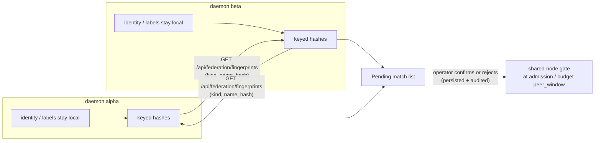

---
docs:
  index: true
  topics: [federation, capacity, queue, compute, budget, peers, security]
exec_steps:
  - tool: federation_fingerprint_matches
    description: List resource-fingerprint matches with federated peers (all states by default; filter optional)
    args:
      state: pending   # optional: pending | confirmed | rejected (omit for all)
    read_only: true
  - tool: federation_fingerprint_confirm
    description: Confirm a match - the two daemons hold the same underlying resource
    args:
      id: "{{params.match_id}}"
    read_only: false
  - tool: federation_fingerprint_reject
    description: Reject a match (also undoes a prior confirmation)
    args:
      id: "{{params.match_id}}"
    read_only: false
  - tool: federation_peer_update
    description: Enable the fingerprint exchange for one peer on this daemon
    args:
      name: "{{params.peer_name}}"
      fingerprint_sync: true
    read_only: false
  - tool: llm_update
    description: Label an LLM entry with the shared billing-group name (same label on both daemons)
    args:
      name: "{{params.llm_name}}"
      billing_group: "{{params.billing_group}}"
    read_only: false
---

# Share-aware capacity across federated peers

Two datawatch daemons can quietly run the *same physical resource*: the
same GPU box reached through two addresses, or two LLM entries that bill
to the same cloud account. Without telling the daemons about it, each
daemon budgets that resource in full — two sessions on alpha, two on
beta, and the physical box (or the plan ceiling) gets double-booked.

The **resource fingerprint exchange** lets the two daemons detect that
they hold the same resource — without either side ever learning the
other's raw identity values, labels, or credentials — and surface each
candidate to you as a **pending match**. You confirm or reject each one.
Once confirmed, a shared compute node is treated as one shared pool
(peer usage counts against your local limit at admission), and a shared
billing group is surfaced so you can fold the peer's spend into your
budget decision (see *Billing groups*, below).

Everything is **opt-in in both directions and off by default**. With no
opted-in peers and no confirmed matches the daemon does nothing new: no
extra HTTP calls, no different admission behaviour.

## What gets fingerprinted

| Kind | Source value (never leaves the host) | Matched as |
|------|--------------------------------------|------------|
| `compute_node` | The node's own identity: its GPU UUIDs, else its disk-persisted node-instance ID — never the name or address you configured for it, so the same box is the same value under a LAN address and a tailnet address | A node whose identity both daemons resolve |
| `billing_group` | The operator-set label on an LLM entry (`billing_group`) that you choose to give to LLMs on both daemons that bill to one account | LLM entries that carry the *same* label on both sides |

A node with no identity source (no observer peer bound, host reported
neither GPU UUIDs nor an instance ID) is simply not fingerprinted —
that is not a failure.

## How detection works

1. Each daemon derives a **pair key**: HMAC-SHA256 over the bearer token
   it uses for the pair, under a fixed message namespace. Both sides
   arrive at the same key independently — no new secret, no new channel.
2. Each daemon computes one **keyed hash per resource** —
   HMAC-SHA256 of `kind + value` under the pair key — and is ready to
   answer `GET /api/federation/fingerprints` with the list
   (`kind`, `name`, `hash`).
3. On a fixed **15-minute cadence** (a built-in constant, not a config
   key), each daemon pulls the fingerprint list of every peer it has
   opted in, and records a **pending match** for every hash that
   appears on both sides. The first exchange runs immediately when the
   daemon starts; a flag you flip at runtime is picked up on the next
   15-minute tick (the peer list is re-read on every pass).
4. Matches are **suggestions**, never auto-decisions. Your confirm/reject
   is persisted under `<data_dir>/autonomous/fingerprint/matches.json`
   and survives restarts. A rejected match **stays rejected** — a
   re-sync can never re-open it. A confirmation can later be undone with
   a reject. Every decision is written to the audit log.

## Effect of a confirmation

- **`compute_node`** — at admission time, the pool check for that node
  adds the peer's live usage of the same node (fetched from the peer's
  `/api/capacity` at check time) to your local in-flight count before
  comparing to your local limit. A task held by this shows the reason
  `shared node busy on peer …` in the wait queue. Only a *confirmed*
  match with an *opted-in* peer triggers a peer call; pending and
  rejected matches never do, and only `node:` pools are affected —
  never the `host`, `llm:` or external pools, and never
  operator-started interactive sessions.
- **`billing_group`** — the confirmation records that both LLMs bill to
  the same account, which feeds your budget decision: name the peer in
  the LLM budget's `peer_window` (CLI `--budget-peer-window`, MCP
  `llm_update`/`budget_set` `peer_window`, config, or the budget's own
  surfaces) and that peer's spend counts toward the ceiling. The
  exchange never modifies your budget by itself.

## Base requirements

- Two datawatch daemons that are already **federated peers of each
  other** (each registered on the other) with a peer-to-peer bearer
  token, and with a federated capability grant that includes the
  fingerprint surface (the full-control grant includes it).
- At least one shared resource of a fingerprinted kind:
  - a compute node reachable from **both** daemons with an identity
    source (observer peer bound on the node, or a local node whose host
    reports GPU UUIDs / node-instance ID), or
  - LLM entries on both daemons that you will give the **same
    `billing_group` label**.
- **Both** daemons must opt in: on each daemon, the peer entry that
  points at the other must have `fingerprint_sync: true`. A capability
  grant does not imply fingerprint trust — the serving daemon answers
  `403` to a peer that has not opted it in, and the pulling daemon
  never even calls a peer whose entry is off.

Enablement per channel (run on **both** daemons, with the *other*
daemon's name):

| Channel | Command / action |
|---------|------------------|
| CLI (new peer) | `datawatch federation peer add --name beta --url <url> --token <tok> --fingerprint-sync` |
| CLI (existing peer) | `datawatch federation peer update beta --fingerprint-sync` — turn it off again with `--fingerprint-sync=false` (the flag is only sent when you set it, so "unset" never resets a previous `true`) |
| Chat (any comm channel) | `federation peer fingerprint beta on` · `federation peer fingerprint beta off` |
| MCP | `federation_peer_add` / `federation_peer_update` with `"fingerprint_sync": true` |
| PWA | Settings → Comms → **Federation Peers** → per-peer **Resource fingerprint exchange** toggle (also a checkbox in the *Add Federation Peer* form) |
| Config (YAML `servers[]` entry) | `fingerprint_sync: true` (default `false`; requires a daemon restart) |

Labelling an LLM with a shared billing group (both daemons, same
label):

| Channel | Command / action |
|---------|------------------|
| CLI | `datawatch llm add … --billing-group shared-plan-a` · `datawatch llm update <name> --billing-group shared-plan-a` (empty value clears it) |
| Chat | `llm add <name> … billing_group=shared-plan-a` (kv-style on the llm verbs) |
| MCP | `llm_add` / `llm_update` with `"billing_group": "shared-plan-a"` |
| PWA | Settings → Compute → **LLM edit** → `billingGroup` field |
| REST | `PUT /api/llms/<name>` with `"billing_group": "shared-plan-a"` |

## Walkthrough: the same GPU box behind two daemons

1. **Opt in both directions.** On daemon `alpha`, enable the exchange
   for peer `beta`; on daemon `beta`, do the same for `alpha` (any
   channel above).
2. **Wait for the first tick** — it runs immediately on daemon start,
   or within 15 minutes of flipping the flag at runtime.
3. **Find the pending match.**
   - CLI: `datawatch fingerprint list --state pending`
   - Chat: `federation fingerprint list pending`
   - MCP: `federation_fingerprint_matches` with `"state": "pending"`
   - REST: `GET /api/federation/fingerprint-matches?state=pending`
   - PWA: Settings → Comms → Federation Peers → **Pending resource
     matches** panel

   Each row shows the id, state, kind, and the local and peer resource
   names — e.g. id `m-7f3a…`, `pending`, `compute_node`, local `rtx4090`,
   peer `beta`, peer name `rtx`.
4. **Decide.** You own the box and both daemons should share it:
   - CLI: `datawatch fingerprint confirm m-7f3a…`
   - Chat: `federation fingerprint confirm m-7f3a…`
   - MCP: `federation_fingerprint_confirm` with the match `id`
   - REST: `POST /api/federation/fingerprint-matches/m-7f3a…/confirm`
   - PWA: the **Confirm** button on the row

   (Same verbs with `rejected`/`reject` when the match is wrong — two
   different boxes that happen to share a name are *not* a match, and
   the identity value, not the name, is what was compared.)
5. **Share-aware admission is now active.** Watch
   `datawatch capacity` / the wait queue on `alpha`: while `beta`'s
   usage on the same box is in flight, `alpha`'s `node:rtx4090` pool
   limit is tested against *combined* usage, and tasks wait with the
   reason `shared node busy on peer beta: …` instead of overloading the
   hardware.

## Walkthrough: the same cloud plan behind two daemons

1. Label the LLM entries: `shared-plan-a` on daemon `alpha`, same label
   on daemon `beta` (any channel above).
2. Opt in both directions as above; within 15 minutes (immediately on a
   restart) a `billing_group` kind match appears in the pending list.
3. Confirm it. It is now on record that both LLMs bill to the same
   account — the audit log carries the decision.
4. Make spend share-aware: set or edit the budget ceiling for that LLM
   on `alpha` and add `beta` to its `peer_window` (CLI
   `datawatch llm update <name> --budget-peer-window beta`, MCP
   `llm_update`/`budget_set` with `peer_window: ["beta"]`, or the
   budget's config/chat surfaces). Now `beta`'s spend against the same
   plan counts toward `alpha`'s ceiling, with the usual
   unreachable-peer-is-skipped (never a stall) behaviour. Check with
   `datawatch budget status` / `GET /api/budget` / MCP `budget_status`.

## When the peer is down

The exchange is deliberately **slow and soft** — it answers *is this
the same resource?*, not *how busy is it right now*:

- **Pull failure.** A peer that does not answer a fingerprint pull
  (timeout, `403` not opted in on their side, malformed body) is logged
  **once per failure episode** (silent until it answers again) and the
  pass continues — one dead peer never blocks the others or the loop.
- **Admission failure.** When the gate checks a confirmed shared node,
  the peer's live usage is polled at that moment; if the peer cannot be
  reached, contributes a wrong status, or does not report the pool, it
  **contributes zero** and your local work is admitted against your own
  counts — admission **fails open** on peer errors. The failure is
  logged once per episode the same way.
- **Decisions are durable.** Peer down-ness never changes match
  records: a rejected match is never re-opened by a later sync, and a
  confirmed one stays confirmed until a reject undoes it.
- **Cadence.** The 15-minute tick is a fixed constant (open by design,
  not a config key): no new polling loop, one shared exchange pass. A
  single peer pull is capped at a 5-second timeout and a 64 KiB body,
  so a broken or hostile peer cannot hang the loop or stream memory.

## What actually crosses the wire

Only three fields per resource leave a daemon: `kind`, `name` (your
own local label for the resource — the only plain-text field) and
`hash`. The identity values themselves — GPU UUIDs, node-instance IDs,
the billing-group label, tokens, addresses, credentials — **never do**,
on either direction of the exchange:

- The hash is HMAC-SHA256 of `kind + value` keyed by the **per-pair
  key** (derived from the pair's bearer token under a fixed message
  namespace). Two different peers holding the same box get *different*
  hashes for it, so peers cannot cross-correlate, and a hash cannot be
  checked against a candidate value without the pair key (there is no
  unkeyed precompute to look up).
- `kind` is mixed into the MAC, so a node identity can never be
  mistaken for a billing-group label (or vice versa) even if the
  underlying strings coincide.
- `GET /api/federation/fingerprints` rejects the local admin token with
  `400` (it has no peer identity), missing bearer tokens with `401`,
  and peers that have not opted in with `403` — a capability grant
  alone is not enough, and both daemons must have opted in.
- Match confirmations and rejections are audit-logged
  (`fingerprint_match_confirmed` / `fingerprint_match_rejected`) with
  the kind, local name and peer name — not the identity values.

## All options — every surface, one table

| Action | CLI | Chat | MCP | REST | PWA |
|--------|-----|------|-----|------|-----|
| Opt peer in/out | `datawatch federation peer update 
 --fingerprint-sync[=false]` (or `--fingerprint-sync` on `peer add`) | `federation peer fingerprint 
 on\|off` | `federation_peer_add` / `federation_peer_update` `fingerprint_sync` | `POST /api/federation/peers` / `PUT /api/federation/peers/<name>` with `fingerprint_sync` | Comms → Federation Peers toggle / Add-peer checkbox |
| List matches | `datawatch fingerprint list [--state pending\|confirmed\|rejected]` | `federation fingerprint list [state]` | `federation_fingerprint_matches` `state?` | `GET /api/federation/fingerprint-matches[?state=]` | Comms → Federation Peers → Pending resource matches panel |
| Confirm | `datawatch fingerprint confirm <id>` | `federation fingerprint confirm <id>` | `federation_fingerprint_confirm` `id` | `POST /api/federation/fingerprint-matches/<id>/confirm` | Confirm button on the row |
| Reject (or undo a confirm) | `datawatch fingerprint reject <id>` | `federation fingerprint reject <id>` | `federation_fingerprint_reject` `id` | `POST /api/federation/fingerprint-matches/<id>/reject` | Reject button |
| Label an LLM billing group | `datawatch llm add\|update … --billing-group <label>` | `llm add <name> … billing_group=<label>` | `llm_add` / `llm_update` `billing_group` | `PUT /api/llms/<name>` `billing_group` | Settings → Compute → LLM edit → `billingGroup` |
| Fold peer spend into a budget | `datawatch llm update <name> --budget-peer-window 
` | budget verbs with `peer_window=
` | `llm_update` / `budget_set` `peer_window` | `PUT /api/llms/<name>` `budget.peer_window` | LLM edit budget section |

Useful REST status codes: `400` (not a peer identity, or not a
federation call for this endpoint), `401` (no bearer token on
`/api/federation/fingerprints`), `403` (peer not opted in), `404`
(unknown match id), `503` (match endpoints not wired).

## See also

- [Automata capacity](automata-capacity.md) — the pools this feature
  shares: `node:<name>`, `llm:<name>`, fair queue and wait reasons.
- [LLM Registry](llm-registry.md) — LLM entries, `plan_tier`,
  `billing_group`, budgets.
- [Federation](../federation.md) — peer registration, capability
  grants, tokens.
- `docs/api-mcp-mapping.md` — endpoint-by-endpoint mapping for the
  fingerprint routes and MCP tools.

---

*Locale note: the new PWA strings for this feature currently ship as
English placeholder values in all five locale bundles (en, de, es, fr,
ja). Treat the non-English strings as first-pass placeholders and
report/replace them when a native pass lands.*
