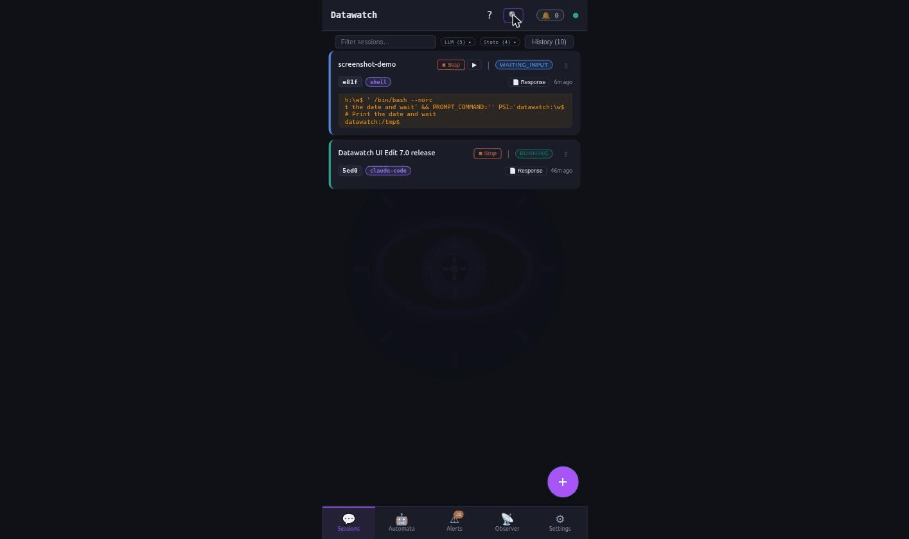
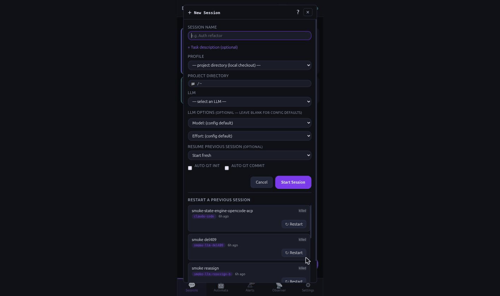
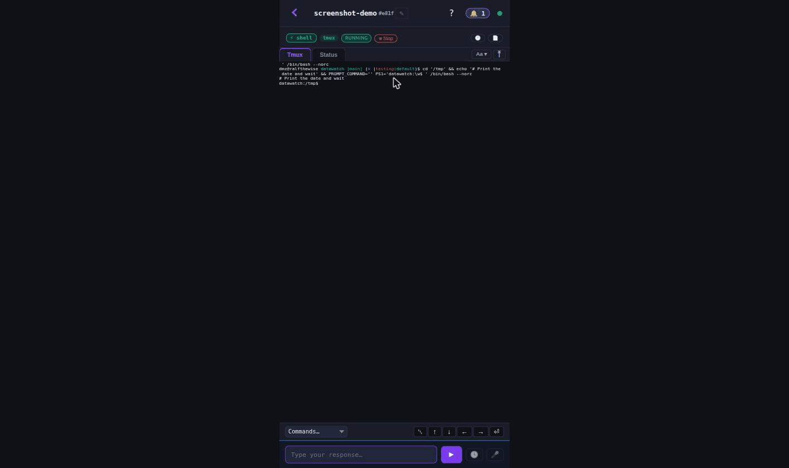
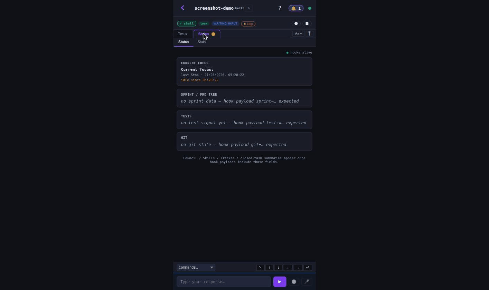
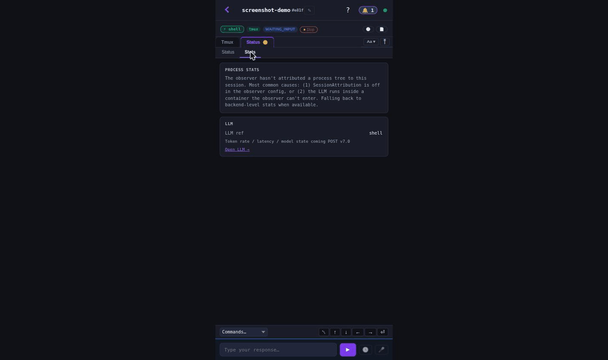

---
docs:
  index: true
  topics: [sessions, tmux, lifecycle]
exec_params:
  - {name: llm, required: true, description: "LLM registry name (e.g. claude-code, my-ollama). Use 'datawatch llm list' to see options."}
  - {name: task, required: true, description: "Initial task / prompt for the session"}
  - {name: project_dir, required: false, default: ".", description: "Working directory"}
  - {name: compute_node, required: false, description: "Compute node name override (must be in the LLM's node list if set)"}
exec_steps:
  - tool: list_sessions
    description: Inventory current sessions before adding a new one
    args: {}
    read_only: true
  - tool: start_session
    description: Spawn the new session with the chosen LLM
    args:
      llm: "{{params.llm}}"
      task: "{{params.task}}"
      project_dir: "{{params.project_dir}}"
    read_only: false
  - tool: session_timeline
    description: Verify the new session is producing events
    args: {}
    read_only: true
---
# How-to: Sessions — deep dive

Long-lived AI work units. Backed by tmux on disk; xterm.js streamed in
the PWA; rich event channel alongside the raw terminal; remembers
itself across daemon restarts. This walkthrough covers what a session
is made of, how it survives a restart, and where to look when it
misbehaves.

## What it is

A directory under `~/.datawatch/sessions/<full_id>/` containing:

```
output.log     ← full append-only tmux output (ANSI preserved)
state.json     ← session metadata (state, last-channel-event, ...)
tracking/      ← per-input record kept by the Tracker
wakeup.log     ← what was injected into L0/L1 layers at start
response.md    ← (optional) last LLM response captured for /copy + alerts
```

A `cs-<full_id>` tmux session attaches to `output.log` via `tmux
pipe-pane`. The LLM runs inside that tmux session.

> **Planned, not shipped:** session history today depends on this
> `pipe-pane` capture and on tmux scrollback. A design pass is approved
> to capture output per turn in chunks so history no longer relies on
> scrollback. Nothing has changed yet: `output.log` stays the full
> append-only record, and the troubleshooting steps below still apply.
> See the [design document](../plans/2026-10-14-turn-chunked-session-history.md)
> (status: needs review) and the backlog row in
> [`docs/plans/README.md`](../plans/README.md). Operator review is still
> needed on its open questions, for example whether the index is encrypted
> for `--secure` sessions and where turn history appears in the PWA.

States: `Running` (LLM processing), `WaitingInput` (paused, awaiting
your reply), `RateLimited` (auto-resumes), `Complete` / `Failed` /
`Killed` (terminal — sticky). See `channel-state-engine.md` for the
state-decision logic.

## How a worker pane is capped

A pane that an Automaton task runs in is held to a memory ceiling. With a systemd user scope, the pane's shell starts inside that scope. Without one, the daemon watches the pane's processes through `/proc` and ends them if they pass the ceiling. With neither, the pane runs uncapped. The session records `ceiling_path` and `ceiling_mb`. Sessions you start yourself are not capped. See [Memory ceiling](../operations.md#memory-ceiling).

## Base requirements

- `datawatch start` — daemon up.
- `tmux` on PATH (every datawatch host needs it).
- At least one LLM configured in the registry (`datawatch llm list`).
  See [`llm-registry.md`](llm-registry.md) to set one up.

## v7 Session fields

v7.0 added two new orthogonal identifiers carried on every session object:

| Field | JSON key | Meaning |
|-------|----------|---------|
| `LLMRef` | `llm_ref` | LLM registry entry name used to start this session (e.g. `claude-code`). Present only when session was started via the v7 `llm` path. |
| `ComputeNodeRef` | `compute_node_ref` | Compute Node the session is bound to. Set when `compute_node` was specified or auto-resolved from the LLM's node list. |
| `BackendFamily` | `backend_family` | Adapter family string (`claude-code`, `ollama`, `opencode`, etc.). Renamed from `llm_backend` in v7.0-alpha.27. External tooling must read `backend_family`; the legacy `llm_backend` key is no longer emitted. |

**Migration note:** If you have scripts or apps reading `sess.llm_backend`, switch them to `sess.backend_family`. Stored `state.json` files from before alpha.27 load cleanly (the daemon accepts both on read), but all new writes use the new key.

## Setup

No setup beyond having a backend. Sessions spawn on demand.

### Project directories and allowed roots

A session may only start in a project directory that lies under an allowed
root. The roots are:

- the Automata worktree base, `autonomous.worktree_dir` (default
  `~/.datawatch/prd-worktrees`);
- the workspace root: `session.workspace_root` when set, otherwise the default
  workspace folder `~/workspace`;
- any folder listed in `server.allowed_project_roots`.

A session started in a folder under `~/workspace` works with no
configuration. The check applies to every way of starting a session (CLI,
REST, MCP, chat and Automaton tasks) and resolves `..` and symlinks first, so
a link that points outside the roots is refused.

A directory outside every root is refused with an error such as:

```
project dir refused: project directory is outside the allowed project roots: "/srv/app" (allowed roots: /home/<user>/.datawatch/prd-worktrees, /home/<user>/workspace; add a root with server.allowed_project_roots)
```

REST answers with a bad-request error. To widen the set, list the folder (or a parent of several
repositories) in `server.allowed_project_roots`, or set `session.workspace_root`
to the parent folder of your repositories; setting it replaces `~/workspace`
as the default. Changes apply without a restart:

```sh
datawatch config set server.allowed_project_roots /srv/projects,~/work
```

See [`operations.md`](../operations.md) "Allowed project roots" for the full rule.

## Two happy paths

### 4a. Happy path — CLI

```sh
# 1. Start a session using the v7 LLM registry.
#    --llm   → LLM registry name (replaces legacy --backend)
#    --compute → optional; must be in the LLM's compute_nodes list if set
SID=$(datawatch sessions start \
  --llm claude-code \
  --project-dir ~/work/foo \
  --task "Audit the auth module for input-validation gaps" 2>&1 \
  | grep -oP 'session \K[a-z0-9-]+')
echo "session: $SID"

# With an explicit compute node (failover override):
SID=$(datawatch sessions start \
  --llm my-ollama --compute gpu-box-1 \
  --task "Refactor the auth module" 2>&1 | grep -oP 'session \K[a-z0-9-]+')

# 2. Watch its state in real time.
watch -n 1 "datawatch sessions get $SID | jq '.state, .last_channel_event_at'"

# 3. Tail the output log (most reliable view of what's happening).
datawatch sessions tail $SID -f
# (or: tail -F ~/.datawatch/sessions/$SID/output.log)

# 4. Send input.
datawatch sessions input $SID "Start with the password reset flow"

# 5. Inspect via API — note v7 field names.
datawatch sessions get $SID | jq
#  → {"id":"abcd","full_id":"peer-d-abcd","state":"running",
#     "task":"...","llm_ref":"claude-code","compute_node_ref":"gpu-box-1",
#     "backend_family":"claude-code","last_channel_event_at":"..."}

# 6. Rebind LLM in-flight (surgical patch, safe while session is running):
datawatch sessions set-llm-ref $SID my-other-llm

# 7. Stop when done.
datawatch sessions kill $SID

# 8. After-the-fact inspection (terminal state):
ls ~/.datawatch/sessions/$SID/
cat ~/.datawatch/sessions/$SID/state.json | jq
tail -50 ~/.datawatch/sessions/$SID/output.log
```

### 4b. Happy path — PWA

1. PWA → bottom nav **Sessions**. The list shows every session this
   daemon knows about; new sessions go to the top by default.
2. **Narrow the list.** One toolbar line sits directly under the page
   heading, at every width — the control-by-control description is in
   [sessions-tiles-and-grouping](sessions-tiles-and-grouping.md#the-toolbar-row).
   In order: a **server select** (the same shared picker as the header
   dropdown — choosing an entry in one updates the other), a **search
   box** that takes the free width of the line, a **Filters** button (a
   badge shows how many filters are active), a **Fold all** icon (while a
   grouping is active) and the **List / Tiles / Compact** view-mode
   select; your view choice is remembered on this device.
   - **Search** — narrows by a session's name, its id, its backend, its
     tag text and its state, so `claude`, `a1f2`, `automation:` or
     `waiting` all work. While a search is active the page shows an
     **N of M** count (for example `3 of 21`).
   - **Filters** — one sheet holds every filter: a **Group by** select
     (none, or by State, Node, Model, Project, Tag, or Automaton), the
     **Views** bar (a name field, a **+ New view** button and the saved
     views as chips), a **Status** chip per real
     state (multi-select; **All** means no filter), a **watched only**
     toggle (list only the sessions you watch) and the **Backend** chips
     (when two or more backends are in use). When any session carries a
     tag, a **Tags** sub-section adds a tag search, per-tag chips with
     counts, an **any / all** match mode and a **Clear**. Selected values
     also show up as removable chips in the compact summary line above
     the list, together with a **Clear all**.
   - **Fold all** — folds or unfolds every group at once; it appears
     while a grouping is active and the visible list has foldable groups.
   - **Tree / History** — a line below the toolbar carries the **Tree**
     and **History (N)** buttons, and the 🌐 hostname chip while a remote
     server is active (click it to return to this server). That line is
     behind the header's 🔍 *search & filters* button (right side of the
     header bar): hidden by default, shown after you switch it on for
     this browser.
   - **Tags** (header icon button) — a separate surface for tags: its
     dropdown also carries a **Watched only** tick that drives the same
     watched-only list, and its **This session** section watches or un-watches
     the open session. See
     [`automata-tags.md`](automata-tags.md#the-header-tags-dropdown).
3. Click the **+** FAB → wizard:
   - **LLM** dropdown (populated from `/api/llms`; disabled entries
     filtered out; adapter kind shown in label).
   - **Compute Node** — cascading dropdown seeded from the chosen LLM's
     `compute_nodes` list. First entry labeled "(primary)"; subsequent
     "(failover N)". Shows "(any node OK)" when the LLM has no pinned
     list.
   - **Model** (populated from that LLM's enabled model list).
   - Task (free-text; one-paragraph task spec). A "— Insert saved
     command —" picker below the field lets you append an entry from
     your saved-command library instead of retyping it.
   - Project Profile (optional — picks workspace + git policy + skills).
   - Effort (only shown for backends that support it).
   - **Start**.
4. The wizard closes; the new session appears at the top of the list
   with state `running` + a green dot.
5. Click into the session card. The **meta-bar** shows:
   - ⚡ `<llm-name>` green badge (v7 LLM registry name, when set).
   - ⚙ `<compute-node>` purple badge (v7 Compute Node, when set).
   - Hover each for a tooltip explaining the v7 field.
   The session header has no time counter and no watch eye. Watching
   moved into the dropdown: open the Tags icon button in the header (the
   solid tag in the accent color, shown brighter while the dropdown is
   open) and, under
   **This session**, press **Watch this session** (or **Stop watching
   this session**). The same section has **Edit tags of this session**.

   The detail view is a **full-height page**: it fills exactly the space
   between the header and the keyboard-aware bottom of the screen, and
   the page itself does not scroll. The tab content takes all the
   space left above the input bar, and the input bar sits flush at that
   bottom — nothing is reserved below the input row (the earlier
   short-box layout left a blank band under it), for your own sessions
   and for a peer's alike. While
   the software keyboard is up the page stays above it and shrinks to
   match; the iOS home-indicator clearance is kept; resizing the window
   or re-zooming the browser re-fits the terminal to the new height with
   no refresh.

   It opens with three tabs:
   - **Tmux** — live xterm.js stream of the LLM's terminal. Read-only
     by default; tap the input bar to send commands. While the session
     is `waiting_input`, Yes/No/Stop quick-reply chips appear above the
     input bar — tap one to send that reply without typing.
   - **Channel** — structured event bubble feed (MCP / ACP /
     chat_message). Native swipe-back through the 1000-entry buffer.
   - **Status** — two sub-tabs:
     - **Status** — hook-fed board: Current focus / Sprint / Tests /
       Git cards (populated when claude-code hook scripts are wired;
       see [`claude-hooks.md`](claude-hooks.md)).
     - **Stats** — CPU ring + RSS + threads + FDs + GPU (if observer
       plugin enabled). Sections layout: process metrics + memory +
       thread/FD counts + optional GPU row.
6. Scroll modes: `Aa ▾` font dropdown (A−, size, A+, Fit) + `📜
   Scroll` enters tmux scroll mode (Page Up / Page Down / ESC tied
   into tmux's scroll-back).
7. State transitions appear as the badge updates (Running ↔
   WaitingInput ↔ Complete). The amber pulsing dot next to the badge
   means "no channel activity for >2 s" (early visual cue).
8. Stop with the **Stop** button in the toolbar.

## Other channels

### 5a. Mobile (Compose Multiplatform)

Same surface in the mobile companion. Tabs and scroll modes work
identically; the input bar uses the OS keyboard with auto-send-on-Enter
optional.

### 5b. REST

```sh
# Start — v7 LLM registry path.
curl -sk -X POST -H "Authorization: Bearer $TOKEN" \
  -H "Content-Type: application/json" \
  -d '{"llm":"claude-code","task":"...","project_dir":"/home/<user>/workspace/myproject"}' \
  $BASE/api/sessions/start

# Start — with explicit compute node.
curl -sk -X POST -H "Authorization: Bearer $TOKEN" \
  -H "Content-Type: application/json" \
  -d '{"llm":"my-ollama","compute_node":"gpu-box-1","task":"..."}' \
  $BASE/api/sessions/start

# List + filter.
curl -sk -H "Authorization: Bearer $TOKEN" \
  "$BASE/api/sessions?state=running&llm=claude-code"

# Get by ID — note v7 field names in response.
curl -sk -H "Authorization: Bearer $TOKEN" $BASE/api/sessions/<full-id>
# → {"id":"...","backend_family":"claude-code","llm_ref":"claude-code",
#    "compute_node_ref":"gpu-box-1","state":"running",...}

# Rebind LLM in-place (safe while session is running).
curl -sk -X POST -H "Authorization: Bearer $TOKEN" \
  -H "Content-Type: application/json" \
  -d '{"id":"<full-id>","llm_ref":"my-other-llm"}' \
  $BASE/api/sessions/set_llm_ref

# Send input.
curl -sk -X POST -H "Authorization: Bearer $TOKEN" \
  -H "Content-Type: application/json" \
  -d '{"id":"<full-id>","text":"..."}' $BASE/api/sessions/<full-id>/input

# Kill.
curl -sk -X POST -H "Authorization: Bearer $TOKEN" \
  -d '{"id":"<full-id>"}' $BASE/api/sessions/kill
```

### 5c. MCP

Tools: `start_session`, `list_sessions`, `session_output`, `send_input`,
`kill_session`, `restart_session`.

`start_session` args: `{"llm": "<registry-name>", "task": "...",
"project_dir": "...", "compute_node": "?", "profile": "?"}`. Returns
the full session metadata including `llm_ref` and `compute_node_ref`.

When invoked from inside an existing session (e.g. claude-code
spawning a sub-session), the parent session ID is recorded so the
two are linked in the cross-session memory subsystem.

### 5d. Comm channel

| Verb | Example |
|---|---|
| `start: <task>` | Spawns a session using the channel's default LLM. |
| `new: llm=<name> [compute=<node>]: <task>` | v7 — picks a specific LLM (and optionally a Compute Node) for this session. |
| `<reply text>` | Continues the most recent session in this chat. |
| `state <id>` | Returns current state. |
| `stop:<id>` | Kills. |
| `restart:<id>` | Restarts a terminal-state session (spawns fresh, seeded from prior). |

Each channel adapter inherits a `session.default_llm` from config
unless overridden per-channel. The `new:` verb routes through the REST
loopback so the same validation (LLM enabled, compute node in list) runs
in one place.

### 5e. YAML

Per-session state at `~/.datawatch/sessions/<id>/state.json` is
operator-readable but daemon-managed — don't hand-edit (race-prone).

For per-spawn-defaults, use Project Profiles
(`~/.datawatch/profiles/projects/<name>.yaml` — see `profiles.md`).
For session templates (saved bundles of backend + effort + skills +
profile), use `~/.datawatch/session-templates/<name>.yaml`.

Session templates schema:

```yaml
name: audit-flow
llm: claude-code
effort: thorough
skills: [secrets-scan, sast]
profile: prod-audit
default_task: |
  Audit the codebase for ...
```

Apply: `datawatch sessions start --template audit-flow`.

### 5f. WebSocket push (mobile / external clients)

`GET /ws` (upgrade) takes the same Bearer token as REST. No subscribe frame
is needed for session-list updates.

**What changed.** The socket used to send every session on connect and
again on every change. On a daemon with about 4,000 sessions that was
about 35 MB per change, which is too much for a phone on a metered
connection. The daemon now sends only the sessions that belong in the
default view, and only what changed.

**The default view.** A session is in it when it is not finished, or when
it finished (complete, failed or killed) within the last
`server.recent_session_minutes` minutes (default 5; a value of 0 or less
also means 5). Finished sessions older than that are never sent over the
socket. Read them over REST instead, with the paged list (see
[list-endpoints-and-paging.md](list-endpoints-and-paging.md)).

**Before and after.** Measured with the hub byte-budget test on a
4,000-session fixture (40 sessions in the default view, each with about
2,500 to 3,000 characters of text). Sizes are the raw WebSocket message
sizes.

| Message | Before | After |
|---|---|---|
| Connect, legacy client (no `hello`) | `sessions` with every session: 35.8 MB | bounded `sessions` frame: 44.8 KB |
| Connect, window client (after `hello`) | not available | rows `sessions` frame: 20.2 KB, once |
| One session changes, window client | `sessions` 35.8 MB and `session_state` 9.0 KB | `session_state` 588 bytes |
| One session changes, legacy client | `sessions` 35.8 MB and `session_state` 9.0 KB | bounded `sessions` 44.8 KB and `session_state` 9.0 KB |
| 20 changes in a row, window client | 20 × 35.8 MB | 11.7 KB in total |

These numbers come from a test fixture, not a live daemon. A live daemon
with longer text or more active sessions sends larger frames. The test
fails any single WebSocket message over 300 KB, so that is the ceiling the
design holds to.

**Which mode you get.**

| Client | Sends in `hello` | On connect | On each change |
|---|---|---|---|
| Window form (new apps and the PWA) | `"session_list":"window"` | bounded legacy frame, then one rows frame after `hello_ack` | `session_state` for the changed session only |
| Legacy (no `hello`, or `full`) | nothing | bounded `sessions` frame | bounded `sessions` frame and the full `session_state` |
| Delta | `"session_list":"delta"` | no `sessions` frame | `session_state` or `session_removed` |

A bounded frame carries `data.more`, `data.total` and `data.window_minutes`.
Long text fields are cut to `server.session_summary_text_chars` and listed
in `truncated_fields`; the full text comes from `GET /api/sessions/{id}`.
The window form and the rest of the message shapes are specified in
[mobile-surface.md](../api/mobile-surface.md#low-bandwidth-client-flow).

**Operator settings.**

- `server.recent_session_minutes` sets the window (default 5). Clients read
  it from `window_minutes` and never hard-code it. `PUT /api/config` applies
  it without a restart.
- `server.session_summary_text_chars` sets how much text a cut field keeps
  (default 200).
- `server.ws_session_list_default` is the mode for clients that never say
  `hello`: `full` (the default) or `delta`. `window` is not valid here,
  because only a client that says `hello` can ask for it.

**Confirm it in a browser's network panel.**

1. Open the PWA in a browser, then open the browser's developer tools.
2. In the Network tab, filter for `WS`, click the `/ws` connection, and open
   its Messages pane (Chrome) or Frames pane (Firefox). Each row is one
   message, with its type and length.
3. On a daemon with about 4,000 sessions, expect a connect `sessions` frame
   of about 45 KB, then one `sessions` rows frame of about 20 KB after the
   client's `hello_ack`, then only small `session_state` rows (about 1 KB or
   less each). No further `sessions` frame should appear.
4. Toggle **Show history**. The history comes from a `GET
   /api/sessions?view=summary...` request in the Fetch/XHR filter, not from a
   new large WebSocket message.

The Playwright story TS-816 (group `wire`) checks these budgets
automatically against the seeded fixture. See
[testing/README.md](../testing/README.md).

### 5g. Image attachments in session input

You can send an image to a running session by putting `[image:<path>]`
in the input text — the PWA's attach control builds that tag from your
upload automatically, so all of the following work the same way:

```sh
# REST — path first uploaded via POST /api/files, or any file the daemon can read
curl -sk -X POST -H "Authorization: Bearer $TOKEN" \
  -H "Content-Type: application/json" \
  -d '{"session_id":"<full-id>","text":"what do you think about this?\n[image:/home/<user>/dw_attach_photo.jpg]"}' \
  $BASE/api/sessions/send
```

**What the daemon does with the tag.** Before the text is typed into
the session, every `[image:<path>]` is read from disk and described by
the vision backend (requires `vision.enabled: true`; see the Vision
System entry in [datawatch-definitions.md](../datawatch-definitions.md)),
and the tag becomes `[image: <description> | path: <path>]` — so the model
gets both the description and the path.

**Every describe call is bounded.** A single describe runs for at most
`vision.describe_timeout_seconds` (a value of 0 or less uses the 5-second
default), enforced on the caller side, so even a backend that ignores
cancellation cannot exceed it. The setting is read on every send — no
restart needed:

```sh
datawatch config set vision.describe_timeout_seconds 15
```

**What the message looks like when the describe fails.** If a call
times out, the backend errors, the description comes back empty, or there
is no vision service at all, the tag degrades to a bare `@<path>` in the
delivered text. The message is still delivered — nothing is dropped — and
a vision-capable model (for example Claude Code) can then read the file at
that path with its own image pipeline. An **unreadable file is a different
case**: a file that is missing, unreadable by the daemon, or outside the
file-service root is never described, and the original `[image:<path>]`
tag passes through **unchanged** — the delivered text carries the literal
tag, not `@<path>` (`TestExpandImageTags_FileNotFound` and
`TestExpandImageTags_PathOutsideRoot` in `internal/server/vision_test.go`
assert exactly this).

**The terminal cannot freeze.** Over a WebSocket, a send that carries an
image tag is expanded on the connection's input worker instead of in the
socket's read loop, so the terminal keeps rendering, scrolling and
typing while the describe runs. Order is preserved **per connection, per
session**: the worker and the wait both live on the WebSocket connection
(`client.inputQueue` + per-connection `inputPending` in
`internal/server/ws.go`), so a later plain send from the *same*
connection to the *same* session waits for the still-expanding image send
to finish rather than overtaking it, and sends to other sessions on that
connection are never blocked. A plain send from a **different** WebSocket
client to the same session is *not* awaited — the ordering guarantee does
not cross sockets. The REST `POST /api/sessions/send` endpoint runs inline, within the same bounded
timeout. If the PWA or terminal appears to wait on an image send, the
wait is the describe itself taking its full budget — cap it with
`vision.describe_timeout_seconds` if your backend is slow.

**Review before relying on it.** Two of the behaviors above are
deliberate, not bugs — check them against your workflow: (1) an unreadable
file arrives as the literal `[image:<path>]` tag, and only the `@<path>`
form is picked up by a model's own `@` file-reading — a model without that
capability sees a tag it may not understand (verify the file exists and is
readable by the daemon); (2) send order only ever waits *within one
WebSocket connection*, so multiple clients sending to the same session can
interleave.

## Diagram

```
       PWA / Mobile / CLI / Comm / REST / MCP
                        │
                        ▼
  ┌──────────────────────────────────────────┐
  │ Daemon                                    │
  │  ┌──────────────┐   ┌─────────────────┐  │
  │  │ Session store│   │ Channel-state   │  │
  │  │  state.json  │◄──┤  engine          │  │
  │  └──────────────┘   └─────────────────┘  │
  │       │                                   │
  │       │ tmux pipe-pane                    │
  │       ▼                                   │
  │  ┌──────────────────────────────────┐    │
  │  │ cs-<id> tmux session              │    │
  │  │   ┌────────────────────────────┐  │    │
  │  │   │ LLM (claude-code / ollama /│  │    │
  │  │   │  opencode / etc.)          │  │    │
  │  │   └────────────────────────────┘  │    │
  │  └──────────────────────────────────┘    │
  └──────────────────────────────────────────┘
              │
              ▼
       output.log (append-only, ANSI preserved)
```

## Claude Code interstitial prompts — recognised and dismissed for you

A lane can sit blocked on a Claude Code interstitial prompt — a question, an idle notice or the autocompact threshold prompt — and look healthy the whole time. datawatch watches the terminal and takes the safe action itself instead of waiting:

1. **It recognises the prompt kind.** Claude Code interstitial prompts are a small, built-in, per-kind table (a fixed set of known kinds), not fuzzy text matching — today the table holds the autocompact threshold question ("Want to autocompact at 400k tokens instead?" with the Autocompact / Keep auto options and the "choose · confirm · Esc not now" hint line). Matching is deliberately strict: all of the prompt's anchor phrases plus its hint line must appear in the pane's last 20 non-empty lines (ANSI stripped), and when a capture is partial or in doubt the classifier returns *none* — a quoted prompt line in output, an idle prompt, or a startup dialog is never acted on.
2. **It dismisses with the safe key, never a blind Enter.** Each kind has one safe dismissal key. For prompts where Enter would pick a choice and change a setting (the autocompact question), the key sent is **Esc** — the "not now" / "dismiss" path — because a wrong Enter is worse than a missed dismissal. It only types when the prompt kind is known and its key is safe.
3. **It is bounded and auditable.** Three timing knobs bound how aggressively it acts, and a switch turns it all off:
   - `session.dismiss_ui_prompts` (default **on**) — the feature switch; `false` restores the old wait-for-you behaviour.
   - `session.ui_prompt_dismiss_delay_seconds` (default **5**) — settle wait after the prompt appears, before the dismissal key is sent, so a transient prompt the session itself resolves in time is left alone.
   - `session.ui_prompt_clear_bound_seconds` (default **30**) — how long datawatch will keep considering the prompt "the one it dismissed" before treating a re-appearance as a fresh prompt needing action.
   - `session.ui_prompt_max_attempts` (default **2**) — retries before the session is flagged for the operator instead of being spamming further keys. When the budget is spent and the prompt is still on screen, or the switch is off, the escalation goes to the operator through the question channel.
4. **When it can't clear it, it hands you the session.** A prompt that survives the retries (or one seen with the switch off) is escalated as an operator question describing the session and the prompt. The session transitions to `waiting_input` (its previous state is restored the moment the prompt clears), and the audit log records the outcome: `ui_prompt_dismissed` (prompt kind, session, key), `ui_prompt_not_cleared` after the budget, `ui_prompt_refused` if a key would not pass the safety allow-list. Counters show up in `ui_prompts` of `GET /api/stats` / the `get_stats` MCP tool and in the `datawatch_ui_prompt_dismissals_total` Prometheus metric.

Change any of the four from the PWA (Settings → Sessions), REST config, MCP `config_set`, `datawatch config set`, or the comm channel — e.g. `configure session.dismiss_ui_prompts=false` to hand the decision back to yourself. There is no per-kind pattern list to hand-edit: the kinds are a built-in table, and adding a new one is a code change with tests, not a config knob. See `datawatch-definitions.md` § Claude Code interstitial prompts.

## Where to look when something is wrong

### "State stuck on `waiting_input` but the session is producing output"

Most likely cause: `LastChannelEventAt` not bumping on output arrival.
Diagnostic walk in `channel-state-engine.md` § Step-by-step debug.

### "Splash never dismisses on session entry"

Open browser dev console. WS messages of type `pane_capture` with
non-empty `lines` should arrive within ~200 ms of subscribe. The
synthesized fallback ensures at least one frame fires; if it doesn't,
check daemon log for `pane_capture` errors.

### "No new lines arriving in `output.log`"

Pipe is broken:

```sh
tmux ls | grep cs-<id>             # confirm tmux session exists
tmux list-panes -t cs-<id>          # confirm pane
datawatch sessions repipe <id>      # manually re-establish the pipe
```

### "Session shows Complete but I'm still working in it"

Grep for the marker that fired the transition:

```sh
grep -n DATAWATCH_COMPLETE ~/.datawatch/sessions/<id>/output.log
```

If the marker fired legitimately, the session IS done from the
daemon's perspective — start a new one.

### "Two sessions both think they own the same tmux pane"

```sh
datawatch sessions list-orphans       # tmux panes with no session record
tmux ls | grep cs-                     # tmux sessions
```

Reconcile by killing the orphan: `tmux kill-session -t cs-<orphan-id>`.

## What a session is told about datawatch

Every session starts with a short platform context: what datawatch is, how its sessions, Automata and channels fit together, and where to look for help. It is delivered in one or both of two ways, depending on the backend:

- **Local file (claude-code).** datawatch writes the text into an **untracked `CLAUDE.local.md`** file in the session's project directory — **not** into `CLAUDE.md` or `AGENT.md`, which it never edits for the platform context. In a git repository the filename is added to the repository's `info/exclude` list, a per-clone ignore list that is itself not tracked, so the write never dirties `git status` and the file can never reach a commit. The marked block is kept up to date, and anything you wrote outside the block is left alone. If the project already tracks its own `CLAUDE.local.md`, datawatch refuses to write into it and that session gets the text as its **first prompt** instead.
- **First prompt (every other backend).** The text is placed at the start of the session's first prompt. This covers pi-prompt, aider, gemini, goose, goose-prompt, ollama, opencode, opencode-acp, opencode-prompt, openwebui, pi, shell and subprocess.

`platform_context_status` (MCP) shows, for one session, whether it is enabled, any project override, the text version and which delivery the session's backend uses (`rules_file`, `first_prompt` or `rules_file_and_first_prompt`).

**Turning it off.**

- Globally: set `platform_context.enabled: false` in the config, use the **Platform context** card in Settings, or send `configure platform_context enabled off` on a comm channel.
- Per project: set `platform_context_enabled: false` (or `true` to keep it on when the global value is off) in that project's policy. The project value wins over the global one.
- To add your own text instead, set `platform_context.note`.

A change applies to sessions started afterwards; a running session keeps what it already received.

**Where it is re-delivered.** When a session's conversation is compacted or cleared, the text would normally be lost. For **claude-code** datawatch installs a SessionStart hook (matching `compact` and `clear`) that prints the text again, so the session gets it back. **No other backend can be re-delivered after compaction**: the first-prompt text is sent once and is not repeated. That covers pi, pi-prompt, aider, gemini, goose, goose-prompt, ollama, opencode, opencode-acp, opencode-prompt, openwebui, shell and subprocess sessions. If one of these backends compacts a long session, restart the session or re-send what it needs.

## Common pitfalls
- **Editing `state.json` by hand.** Race-prone. Use the API.
- **Confusing `last_channel_event_at` with `updated_at`.** UpdatedAt
  is bumped by daemon-internal housekeeping (rate-limit timer,
  reconcile, etc.). LCE is the real activity signal.
- **Spawning without a profile.** Default LLM + workspace are
  fine for chat sessions, but for long-running work a Project Profile
  saves repeated config and gives the LLM cleaner context.
- **Killing a session while reading its output.** Safe — kill closes
  the pipe and marks state Killed; the log file stays for inspection.

## Live Task Tree + Status Tab Dashboard

The **Status** sub-tab now shows a live task tree populated from structured
telemetry. It updates in real-time via WebSocket `hook_update` events — no
manual refresh needed.

**Session types detected automatically:**

| Type | Source | Notes |
|------|--------|-------|
| `automata` | Sprint `prd_id` in telemetry | Links to Automata detail |
| `cc` | TodoWrite hook events | Task IDs start with `todo-` |
| `test-runner` | `tests` in telemetry | Pass/fail/skip counts |
| `generic` | Fallback | Shows raw task list |

**On-demand guardrail invocation** from the Status tab: use the
Commands dropdown → Guardrails group to run `sast-scan`, `secrets-scan`,
or `deps-scan` against the session's project directory. The verdict is
appended to the session's telemetry immediately.

```sh
# Via CLI
datawatch session guardrail <session-id> sast-scan

# Via REST
curl -X POST https://localhost:8443/api/sessions/<id>/guardrail \
     -H 'Authorization: Bearer TOKEN' \
     -d '{"name":"sast-scan"}'
```

**Sprint ancestry breadcrumb** — when `telemetry.sprint.prd_id` is
present, the task tree card shows a clickable breadcrumb linking to the
Automata detail view.

**Parent session link** — if `telemetry.parent_session_id` is set, a
link appears at the top of the Status pane to navigate to the spawning
session.

**Deep-link from Automata detail**: each story's worker session row now
has a "● Status" button that navigates directly to that session's Status
sub-tab.

## Linked references

- Channel state engine: [`channel-state-engine.md`](channel-state-engine.md)
- Profiles: [`profiles.md`](profiles.md)
- Architecture: `../architecture-overview.md`
- Guardrails: [`guardrail-library.md`](guardrail-library.md)
- See also: `daemon-operations.md` for restart + log management

## Screenshots







Note: the Tmux tab is a full-height page. The terminal pane fills the space between the header and the keyboard-aware bottom of the screen, and the saved-commands row (with the tmux shortcut keys) and the “Send command or input…” input row sit flush at that bottom — there is no empty band below them. Resizing the window or zooming the browser re-fits the terminal pane without a reload.





<!-- Screenshots still needed: Channel tab bubble feed, loading splash, stale-comms amber dot -->

---

## See also

- [datawatch-definitions](../datawatch-definitions.md)
- [howto/channel-state-engine](channel-state-engine.md)
- [howto/chat-and-llm-quickstart](chat-and-llm-quickstart.md)
- [howto/llm-registry](llm-registry.md)
- [howto/compute-nodes](compute-nodes.md)
- [howto/comm-channels](comm-channels.md)
- [howto/mcp-tools](mcp-tools.md)
- [architecture-overview](../architecture-overview.md)
- [api/sessions](../api/sessions.md)
